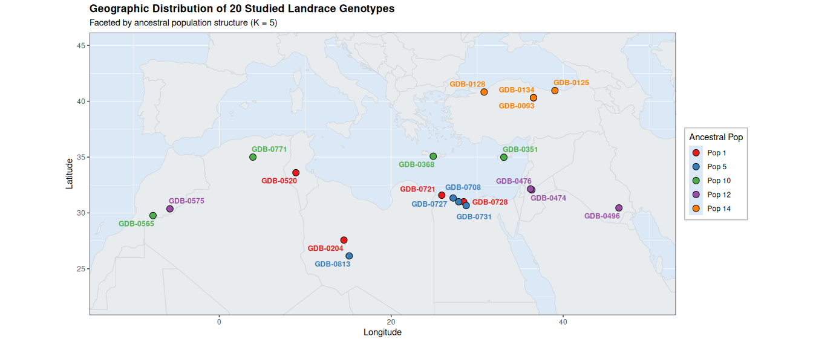
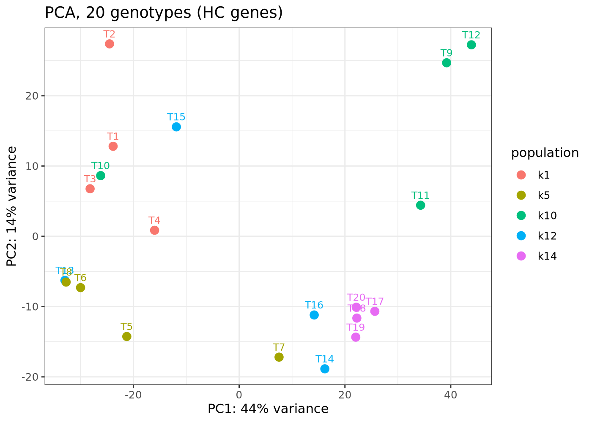
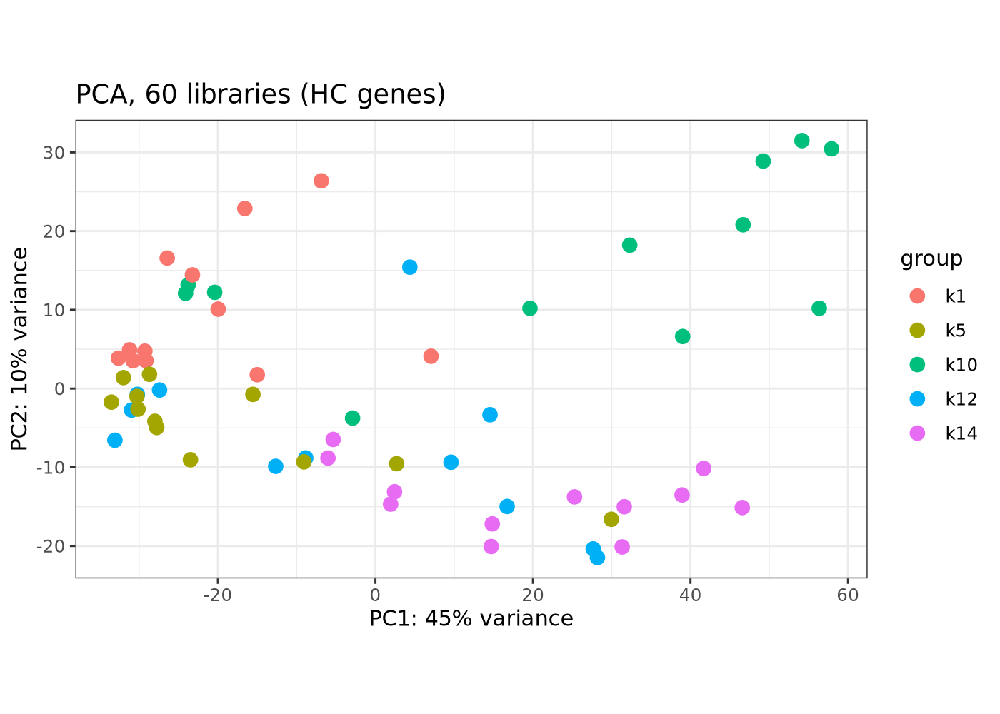
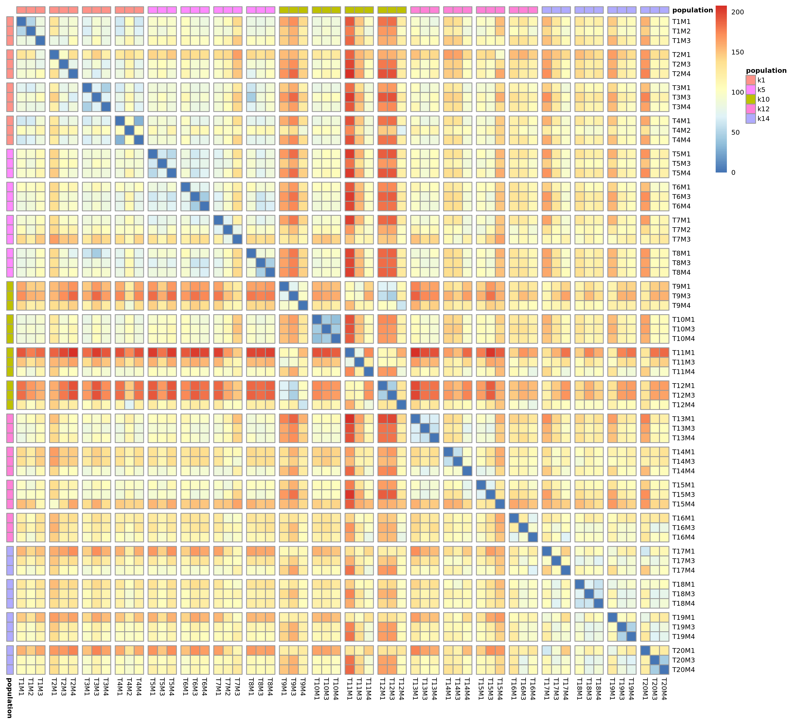
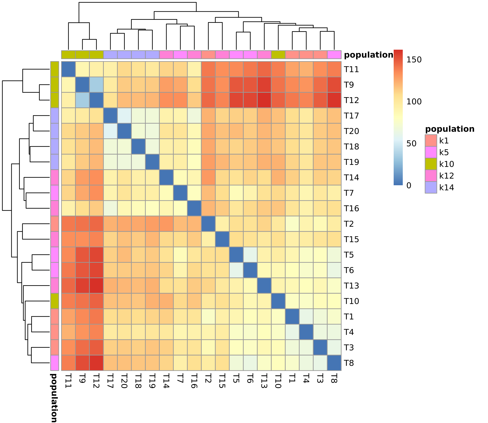
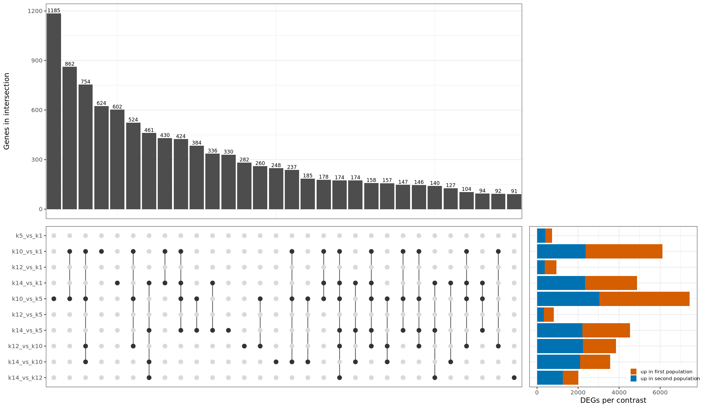
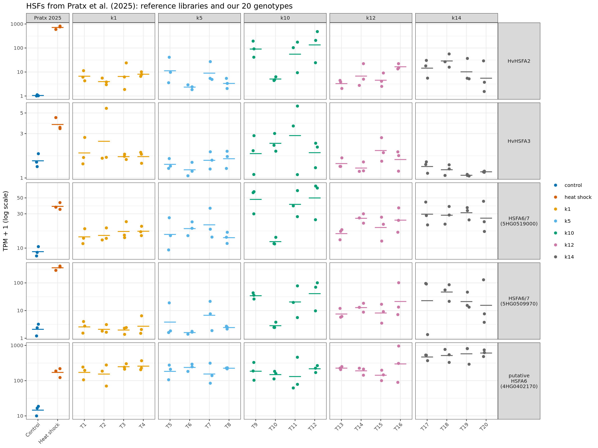

# Transcriptomic fingerprints across five Mediterranean barley populations

This repository holds the code and processed inputs for a study of
Mediterranean barley (*Hordeum vulgare*) landraces exposed to heat stress at
the flowering stage. It documents how the raw RNA-seq reads are cleaned and
quantified, up to the gene-level count matrices in `data/input/`, and the
analyses done on them (see [Analysis](#analysis)).

## Samples

The study includes 20 six-rowed landraces (GDB accessions) from around the
Mediterranean basin. They belong to five ancestral populations (`k1`, `k5`,
`k10`, `k12`, `k14`), with four genotypes per population. [Here I should add Chesco's paper reference].



Each genotype is identified by its number (`T1`–`T20`) in library names and
results. Three plants (biological replicates) of each genotype were
sequenced; library `T<genotype>M<plant>` is one plant.

| Genotype | Accession | Country | Spike | Population | Libraries (plants) |
|---|---|---|---|---|---|
| T1 | GDB-0204 | LBY | 6-rowed | k1 | T1M1, T1M2, T1M3 |
| T2 | GDB-0520 | TUN | 6-rowed | k1 | T2M1, T2M3, T2M4 |
| T3 | GDB-0721 | EGY | 6-rowed | k1 | T3M1, T3M3, T3M4 |
| T4 | GDB-0728 | EGY | 6-rowed | k1 | T4M1, T4M2, T4M4 |
| T5 | GDB-0708 | EGY | 6-rowed | k5 | T5M1, T5M3, T5M4 |
| T6 | GDB-0727 | EGY | 6-rowed | k5 | T6M1, T6M3, T6M4 |
| T7 | GDB-0731 | EGY | 6-rowed | k5 | T7M1, T7M2, T7M3 |
| T8 | GDB-0813 | LBY | 6-rowed | k5 | T8M1, T8M3, T8M4 |
| T9 | GDB-0351 | CYP | 6-rowed | k10 | T9M1, T9M3, T9M4 |
| T10 | GDB-0368 | GRC | 6-rowed | k10 | T10M1, T10M3, T10M4 |
| T11 | GDB-0565 | MAR | 6-rowed | k10 | T11M1, T11M3, T11M4 |
| T12 | GDB-0771 | DZA | 6-rowed | k10 | T12M1, T12M3, T12M4 |
| T13 | GDB-0474 | JOR | 6-rowed | k12 | T13M1, T13M3, T13M4 |
| T14 | GDB-0476 | JOR | 6-rowed | k12 | T14M1, T14M3, T14M4 |
| T15 | GDB-0496 | IRQ | 6-rowed | k12 | T15M1, T15M3, T15M4 |
| T16 | GDB-0575 | MAR | 6-rowed | k12 | T16M1, T16M3, T16M4 |
| T17 | GDB-0093 | TUR | 6-rowed | k14 | T17M1, T17M3, T17M4 |
| T18 | GDB-0125 | TUR | 6-rowed | k14 | T18M1, T18M3, T18M4 |
| T19 | GDB-0128 | TUR | 6-rowed | k14 | T19M1, T19M3, T19M4 |
| T20 | GDB-0134 | TUR | 6-rowed | k14 | T20M1, T20M3, T20M4 |

The population is the `K17_pop` value of the genotype (population `k1` =
`K17_pop` 1, and so on). Full sample information is in
[`data/input/samples_metadata.tsv`](data/input/samples_metadata.tsv), with
these columns:

| Column | Content |
|---|---|
| (first) | genotype number, 1–20 |
| `Name` | GDB accession |
| `Spike` | spike type |
| `Country` | country of origin (ISO 3166 alpha-3) |
| `Latitude`, `Longitude` | collection site, decimal degrees (decimal comma) |
| `K17_pop`, `K17_maxQ` | population assignment and maximum ancestry coefficient at K = 17 |

The first column is the genotype number: row *n* is genotype `Tn`. The count
matrices contain the 60 libraries listed above.

## Data availability

The 2 × 150 bp paired-end Illumina reads (~9 Gb per library) were produced by
BMKGENE (Biomarker Technologies). They are not stored in this repository. They
will be deposited in the European Nucleotide Archive (ENA), and the accession
will be added here when the embargo ends.

## Repository structure

```text
transcriptomic-fingerprints-five-mediterranean-populations/
├── README.md
├── docs/figures/                               # figures used in this README
├── envs/                                       # one conda environment per tool group
│   ├── qc.yml                                  # FastQC, fastp
│   ├── reference.yml                           # gffread, RSEM
│   ├── kallisto.yml                            # kallisto
│   ├── tximport.yml                            # R, tximport
│   └── deseq2.yml                              # R, DESeq2, ggplot2, pheatmap (analysis)
├── references/                                 # Morex V3 reference files (large files Git-ignored)
│   ├── MorexV3.fa                              # genome (modified headers, see below)
│   ├── MorexV3.gff3                            # gene annotation
│   ├── MorexV3.gtf                             # filtered GTF used for quantification
│   ├── MorexV3.transcripts.fa                  # transcript sequences indexed by kallisto
│   ├── MorexV3.idx                             # kallisto index
│   ├── MorexV3_tx2gene.tsv                     # transcript -> gene
│   ├── MorexV3_gene_confidence.tsv             # gene -> high / low confidence
│   ├── annotation/                             # GO sources (Part B), SOURCES.tsv, gene2go_HC.tsv
│   └── MD5SUMS
├── data/
│   ├── raw/                                    # raw FASTQ (local only)
│   ├── processed/                              # clean FASTQ, merged matrix (local only)
│   └── input/
│       ├── samples_metadata.tsv
│       ├── samplesheet.tsv                     # library ID -> raw FASTQ files
│       ├── samplesheet_D.tsv                   # Part D reference libraries (6 runs, condition)
│       ├── samplesheet_E.tsv                   # same, Part E control experiment (15 libraries)
│       ├── raw_MD5SUMS                         # provider checksums of the raw FASTQ
│       ├── kallisto.merged.gene_counts.HC.tsv  # high-confidence genes
│       ├── kallisto.merged.gene_counts.LC.tsv  # low-confidence genes
│       ├── kallisto.E.gene_counts.HC.tsv       # Part E, high-confidence genes
│       ├── kallisto.E.gene_counts.LC.tsv       # Part E, low-confidence genes
│       ├── pratx2025_ENA_MD5SUMS               # ENA checksums of the Part D reference FASTQ
│       └── MD5SUMS
├── results/
│   ├── upstream/                               # per library: fastp JSON + log, kallisto
│   │                                           # abundance.h5, run_info.json, log (tracked)
│   │                                           # FastQC, fastp HTML, abundance.tsv (local only)
│   ├── A_deg/                                  # Part A: differential expression
│   ├── B_go/                                   # Part B: GO enrichment of DEG groups
│   ├── C_cherrypicking/                        # Part C: selected gene groups
│   ├── D_validation/                           # Part D: external reference (Pratx et al. 2025)
│   └── E_control/                              # Part E: control vs heat experiment
└── scripts/
    ├── gene_counts.R                           # Step 4
    ├── A_deg_populations.R                     # Part A
    ├── B_go_enrichment.R                       # Part B
    ├── C_cherrypicking.R                       # Part C
    ├── D_reference_upstream.sh                 # Part D, Step D2
    ├── D_treatment_validation.R                # Part D, Step D4
    └── E_control_validation.R                  # Part E
```

## Software and environments

| Tool | Version | Used for | Environment |
|---|---|---|---|
| FastQC | 0.12.1 | read quality reports | `envs/qc.yml` |
| fastp | 1.3.6 | read cleaning | `envs/qc.yml` |
| gffread | 0.12.7 | GFF3 → GTF | `envs/reference.yml` |
| RSEM (`rsem-prepare-reference`) | 1.3.1 | transcript FASTA from genome + GTF | `envs/reference.yml` |
| kallisto | 0.52.0 | index and quantification | `envs/kallisto.yml` |
| R | 4.3.3 | transcript → gene summarisation | `envs/tximport.yml` |
| tximport | 1.30.0 | transcript → gene summarisation | `envs/tximport.yml` |
| rhdf5 | 2.44.0 | lets tximport read `abundance.h5` | `envs/tximport.yml` |
| R | 4.5.3 | analysis (Parts A, B) | `envs/deseq2.yml` |
| DESeq2 | 1.50.2 | differential expression | `envs/deseq2.yml` |
| ggplot2 | 4.0.3 | plots | `envs/deseq2.yml` |
| pheatmap | 1.0.13 | heatmaps | `envs/deseq2.yml` |
| gridExtra | 2.3.1 | UpSet plot layout | `envs/deseq2.yml` |

Each tool group has its own conda environment, which keeps dependencies
small and avoids version conflicts between unrelated tools. Create them with:

```bash
conda env create -f envs/qc.yml          # -> barley-qc
conda env create -f envs/reference.yml   # -> barley-reference
conda env create -f envs/kallisto.yml    # -> barley-kallisto
conda env create -f envs/tximport.yml    # -> barley-tximport
conda env create -f envs/deseq2.yml      # -> barley-deseq2
```

Activate the environment named in each step with `conda activate <name>`.
`grep`, `sed`, `awk`, `md5sum` and `sha256sum` are standard Unix tools.

## Reference genome and annotation

The reference is the barley cv. Morex genome assembly and gene annotation,
version 3 (Morex V3):

- Mascher M, Wicker T, Jenkins J, *et al.* (2021). Long-read sequence
  assembly: a technical evaluation in barley. *The Plant Cell* 33:1888–1906.
  <https://doi.org/10.1093/plcell/koab077>
- Data release: "Pseudomolecules and annotation of the third version of the
  reference genome sequence assembly of barley cv. Morex [Morex V3]", IPK
  Gatersleben. <https://doi.org/10.5447/ipk/2021/3>

Two files of the release are used:

| IPK file | Size | MD5 | Local name |
|---|---:|---|---|
| `Barley_MorexV3_pseudomolecules.fasta` | 4,296,032,540 B | `621c39c513f2f55a26fd9cf3e9c8850a` | `references/MorexV3.fa` (headers renamed) |
| `Hv_Morex.pgsb.Jul2020.gff3` | 95,708,927 B | `18d7100cf9e97cda4dcc31cce748903a` | `references/MorexV3.gff3` (unchanged) |

Download them and build the local files. The chromosome names stay
`chr1H` … `chr7H` and `chrUn`; only the tag `sampleName=MorexV3` is added to
each FASTA header (for example `>chr1H sampleName=MorexV3`). Sequence names
in the GFF3 already match. Each gene model has a `confidence` attribute
(`high` or `low`), which is used in Step 5.

```bash
mkdir -p references/ipk
cd references/ipk
B=https://doi.ipk-gatersleben.de/DOI/b2f47dfb-47ff-4114-89ae-bad8dcc515a1
wget -c "$B/b6e6a2e5-2746-4522-8465-019c8f56df7f/1/DOWNLOAD" -O Barley_MorexV3_pseudomolecules.fasta
wget -c "$B/5d16cc17-c37f-417f-855d-c5e72c721f6c/1/DOWNLOAD" -O Hv_Morex.pgsb.Jul2020.gff3
md5sum Barley_MorexV3_pseudomolecules.fasta Hv_Morex.pgsb.Jul2020.gff3   # compare with the table
cd ../..
sed 's/^>\(.*\)$/>\1 sampleName=MorexV3/' references/ipk/Barley_MorexV3_pseudomolecules.fasta \
    > references/MorexV3.fa
cp references/ipk/Hv_Morex.pgsb.Jul2020.gff3 references/MorexV3.gff3
```

Check that your reference files are identical to the ones used:

```bash
cd references
md5sum -c MD5SUMS
```

## Processing: raw reads to gene count matrices

### Step 0 — raw reads

BMKGENE delivered one pair of files per library, named
`Unknown_CU317-001T00NN_1.fq.gz` and `Unknown_CU317-001T00NN_2.fq.gz`. Put the
FASTQ files of the 60 study libraries in `data/raw/`.

- [`data/input/samplesheet.tsv`](data/input/samplesheet.tsv) links each
  library ID to its two files (`library_id`, `fastq_1`, `fastq_2`). It was
  built from the provider's name table and lists the 60 study libraries
  (genotypes T1–T20). Every step below reads it.

### Step 1 — reference preparation

Environment: `barley-reference`, then `barley-kallisto`.

1. **Convert the GFF3 to GTF.** kallisto and RSEM read GTF. `--keep-exon-attrs`
   keeps attributes on exon lines, `-F` keeps all GFF attributes (including
   `confidence`), and `-T` writes GTF.

   ```bash
   gffread references/MorexV3.gff3 --keep-exon-attrs -F -T -o MorexV3.unfiltered.gtf
   ```

2. **Filter the GTF.** Keep only lines whose chromosome exists in the genome
   FASTA and that carry a `transcript_id`. This guarantees every annotated
   transcript can be extracted from the genome. The first command lists the
   chromosome names in the FASTA; the second keeps the matching GTF lines.

   ```bash
   grep '^>' references/MorexV3.fa | sed 's/^>//; s/ .*//' > chroms.txt
   awk -F'\t' 'NR==FNR{keep[$1]; next} !/^#/ && ($1 in keep) && /transcript_id "/' \
       chroms.txt MorexV3.unfiltered.gtf > references/MorexV3.gtf
   ```

3. **Extract the transcript sequences.** RSEM writes one sequence per GTF
   transcript (83,990 transcripts).

   ```bash
   mkdir -p rsem
   rsem-prepare-reference --gtf references/MorexV3.gtf --num-threads 12 \
       references/MorexV3.fa rsem/genome
   cp rsem/genome.transcripts.fa references/MorexV3.transcripts.fa
   ```

4. **Build the kallisto index** with k-mer length 31.

   ```bash
   kallisto index -k 31 -i references/MorexV3.idx references/MorexV3.transcripts.fa
   ```
5. **Write the transcript-to-gene table.** One line per transcript:
   transcript ID, gene ID. Step 4 uses it.

   ```bash
   awk -F'\t' '$3=="transcript"' references/MorexV3.gtf \
     | grep -o 'transcript_id "[^"]*"\|gene_id "[^"]*"' | paste - - \
     | sed 's/transcript_id "//; s/"\tgene_id "/\t/; s/"$//' \
     > references/MorexV3_tx2gene.tsv
   ```

### Step 2 — clean reads

Environment: `barley-qc`.

For each library in the samplesheet, the loop:

1. writes a FastQC report on the raw reads;
2. cleans the read pair with fastp (JSON and HTML reports, plus the fastp
   log);
3. writes a FastQC report on the clean reads.

The clean reads go to `data/processed/fastp/` and the reports to
`results/upstream/`.

```bash
mkdir -p data/processed/fastp results/upstream/fastp/log \
         results/upstream/fastqc/raw results/upstream/fastqc/trim

tail -n +2 data/input/samplesheet.tsv | while IFS=$'\t' read -r id fq1 fq2; do
    echo "== ${id}"

    fastqc --threads 6 --outdir results/upstream/fastqc/raw \
        data/raw/${fq1} data/raw/${fq2}

    fastp \
        --in1 data/raw/${fq1} \
        --in2 data/raw/${fq2} \
        --out1 data/processed/fastp/${id}_R1.fastp.fastq.gz \
        --out2 data/processed/fastp/${id}_R2.fastp.fastq.gz \
        --json results/upstream/fastp/${id}.fastp.json \
        --html results/upstream/fastp/${id}.fastp.html \
        --thread 6 --detect_adapter_for_pe \
        -q 30 -u 15 -y -g -Y 10 -l 100 -b 150 -B 150 \
        2> results/upstream/fastp/log/${id}.fastp.log

    fastqc --threads 6 --outdir results/upstream/fastqc/trim \
        data/processed/fastp/${id}_R1.fastp.fastq.gz data/processed/fastp/${id}_R2.fastp.fastq.gz
done
```

fastp options:

| Option | Effect |
|---|---|
| `--detect_adapter_for_pe` | detects and removes adapters from the read-pair overlap |
| `-q 30 -u 15` | a base is low quality below Q30; a read is discarded if more than 15 % of its bases are low quality |
| `-y -Y 10` | low-complexity filter; discards reads with less than 10 % complexity |
| `-g` | trims poly-G tails (an artefact of two-colour Illumina chemistry) |
| `-l 100` | discards reads shorter than 100 bases after trimming |
| `-b 150 -B 150` | caps read 1 and read 2 at 150 bases |

### Step 3 — quantification

Environment: `barley-kallisto`.

kallisto pseudoaligns each library's clean read pairs to the transcript
index and estimates read counts per transcript. kallisto runs in unstranded
mode (no strand option). `--gtf` lets kallisto place transcripts on the
genome; it does not change the counts. The kallisto log is saved next to the
results.

```bash
tail -n +2 data/input/samplesheet.tsv | while IFS=$'\t' read -r id fq1 fq2; do
    echo "== ${id}"
    mkdir -p results/upstream/kallisto/${id}
    kallisto quant --threads 12 --index references/MorexV3.idx \
        --gtf references/MorexV3.gtf \
        -o results/upstream/kallisto/${id} \
        data/processed/fastp/${id}_R1.fastp.fastq.gz data/processed/fastp/${id}_R2.fastp.fastq.gz \
        2> results/upstream/kallisto/${id}/kallisto_quant.log
done
```

Each library folder holds `abundance.tsv` (estimated counts and TPM per
transcript), `abundance.h5`, `run_info.json` and `kallisto_quant.log`.

### Step 4 — gene-level count matrix

Environment: `barley-tximport`.

[`scripts/gene_counts.R`](scripts/gene_counts.R) reads the kallisto
`abundance.h5` of every library in the samplesheet. It adds up the estimated
counts of all transcripts of a gene, using `references/MorexV3_tx2gene.tsv`.
Counts are kept as estimated by kallisto, with no length or library-size
scaling. Libraries are written in a fixed (C-locale) order so the output does
not depend on the computer's settings.

```bash
Rscript scripts/gene_counts.R
```

Output: `data/processed/kallisto.merged.gene_counts.tsv`, with the columns
`gene_id`, `gene_name` and one column per library (60), and 81,687 genes.
The script also writes `data/processed/kallisto.merged.gene_tpm.tsv`, the
same layout with TPM (transcripts per million, the sum of the kallisto TPM of
each gene's transcripts), used for absolute expression levels in Part D.

### Step 5 — split by gene confidence

Plain `awk`; nothing is re-quantified.

1. **Label each gene high or low confidence.** Morex V3 classifies every
   gene model as high (HC) or low (LC) confidence. A gene is labelled HC if
   at least one of its transcripts is HC. This applies to 6 genes that have
   both HC and LC transcripts: `HORVU.MOREX.r3.1HG0014570`, `2HG0208750`,
   `3HG0285290`, `4HG0407700`, `6HG0587730`, `7HG0697810`. Result: 35,827 HC
   and 45,860 LC genes.

   ```bash
   awk -F'\t' '$3=="transcript"' references/MorexV3.gtf \
    | grep -o 'gene_id "[^"]*"\|confidence "[^"]*"' | paste - - \
    | sed 's/gene_id "//; s/"\tconfidence "/\t/; s/"$//' | sort -u \
    | awk 'BEGIN{OFS="\t"; print "gene_id","confidence"}
           {if(!($1 in c) || $2=="high") c[$1]=$2}
           END{for(g in c) print g,c[g]}' > references/MorexV3_gene_confidence.tsv
   ```

2. **Split the matrix.** Each gene row goes to the HC or LC file. Both files
   keep the header and the same 60 columns. The split happens after
   quantification, so reads were assigned with all HC and LC transcripts in
   the index.

   ```bash
   M=data/processed/kallisto.merged.gene_counts.tsv
   awk -F'\t' 'NR==FNR{c[$1]=$2; next} FNR==1 || c[$1]=="high"' \
     references/MorexV3_gene_confidence.tsv $M > data/input/kallisto.merged.gene_counts.HC.tsv
   awk -F'\t' 'NR==FNR{c[$1]=$2; next} FNR==1 || c[$1]=="low"' \
     references/MorexV3_gene_confidence.tsv $M > data/input/kallisto.merged.gene_counts.LC.tsv
   ```

   Expected: 35,827 + 45,860 = 81,687 genes, no gene in both files, and for
   every library the HC and LC counts add up to the total in `$M`.

3. **Verify** the matrices against the ones in this repository:

   ```bash
   cd data/input
   md5sum -c MD5SUMS
   ```

The downstream analysis uses the **HC** matrix. The LC matrix is kept for
reference.

## Analysis

### Part A — Genes differentially expressed between populations

**Question.** Which high-confidence genes differ in expression between the
five populations under heat stress at flowering? All 60 plants were
heat-stressed and there is no control group, so these are differences between
populations under heat, not heat responses.

**How.** Environment `barley-deseq2`:

```bash
Rscript scripts/A_deg_populations.R
```

1. **Input:** `data/input/kallisto.merged.gene_counts.HC.tsv`
   (35,827 HC genes × 60 libraries). kallisto's estimated counts are rounded
   to whole numbers, as DESeq2 requires.
2. **One replicate per genotype.** The three plants of a genotype are not
   independent observations of a population, so their counts are summed
   (`collapseReplicates`). This gives 20 genotypes, 4 per population, which
   act as the replicates of each population.
3. **Model:** DESeq2 with design `~ population`.
4. **Omnibus test** (likelihood-ratio test, `~ population` vs `~ 1`): does a
   gene's expression differ anywhere among the five populations? A gene is a
   DEG when its Benjamini–Hochberg adjusted p-value is < 0.05. No fold-change
   filter is applied.
5. **Pairwise tests** (Wald test, 10 population pairs): which populations
   differ, and in which direction. Same criterion, adjusted p < 0.05.

**Results.** 35,827 HC genes; 22,304 tested (the rest removed by DESeq2's
independent filtering); **10,497 DEGs** in the omnibus test.

| Pairwise contrast | DEGs | Up in first population | Up in second population |
|---|---:|---:|---:|
| k5 vs k1 | 730 | 323 | 407 |
| k10 vs k1 | 6,114 | 3,742 | 2,372 |
| k12 vs k1 | 950 | 579 | 371 |
| k14 vs k1 | 4,878 | 2,532 | 2,346 |
| k10 vs k5 | 7,441 | 4,410 | 3,031 |
| k12 vs k5 | 824 | 484 | 340 |
| k14 vs k5 | 4,530 | 2,317 | 2,213 |
| k12 vs k10 | 3,845 | 1,605 | 2,240 |
| k14 vs k10 | 3,557 | 1,457 | 2,100 |
| k14 vs k12 | 2,008 | 751 | 1,257 |

"Up in first population": higher expression in the first population named
(e.g. k10 in "k10 vs k1").

#### Figures

**PCA of the 20 genotypes.**



PCA of all HC genes after DESeq2's variance-stabilising transformation
(VST, blind to the design). Each dot is one genotype (3 plants summed),
labelled T1–T20 and coloured by population. Axis labels give the percentage
of variance explained. Nearby dots have similar expression profiles.

**PCA of the 60 libraries.**



Same as above, with one dot per plant.

**Distances between the 60 libraries.**



Euclidean distance between libraries (VST, all HC genes): blue is similar, red
is different. Libraries are ordered by population, genotype and plant, with no
clustering. White gaps separate genotypes, so each 3 × 3 block on the
diagonal holds the plants of one genotype. The side strip shows the
population.

**Distances between the 20 genotypes.**



Same distance and colours, with the three biological replicates (plants) of
each genotype collapsed into one column by summing their counts, as in the
DEG tests. This removes plant-to-plant variation and compares genotypes
only. Genotypes are clustered on these distances (hierarchical clustering,
complete linkage), and the trees on the top and left show how they group:
genotypes joined lower in the tree have more similar expression profiles. The
colour strips show the population.

**Overlap of the pairwise DEG sets (UpSet plot).**



- **Dot matrix:** each column is a group of genes that are DEGs in exactly
  the contrasts marked with black dots.
- **Top bars:** number of genes in each group (the 30 largest groups).
- **Right bars:** total DEGs per contrast. Orange: up in the first population
  of the contrast. Blue: up in the second.

#### Output files (`results/A_deg/`)

| File | Content |
|---|---|
| `omnibus_LRT_all_genes.tsv` | omnibus test for every HC gene (`baseMean`, `stat`, `pvalue`, `padj`). The `log2FoldChange` column of this table is k14 vs k1 only, not a summary of the test. |
| `omnibus_LRT_DEGs.tsv` | the 10,497 omnibus DEGs |
| `omnibus_summary.tsv` | gene counts |
| `pairwise_<A>_vs_<B>.tsv` | Wald test for each of the 10 contrasts; `log2FoldChange` > 0 means higher in A |
| `pairwise_summary.tsv` | DEGs per contrast and direction |
| `pairwise_DEGs_long.tsv` | every pairwise DEG with its contrast and direction |
| `upset_top30_intersections.tsv` | the 30 intersections in the UpSet plot |
| `library_table.tsv` | library → genotype → population |
| `size_factors_genotypes.tsv` | DESeq2 size factors (sequencing depth correction) per genotype |

### Part B — Functions of the genes that differ between populations

**Question.** Which biological functions are over-represented among the genes
that differ between populations?

**Gene Ontology (GO)** is a standard vocabulary that describes what genes do,
in three categories:

- **Biological process (BP):** what the gene takes part in, e.g. "response
  to heat".
- **Molecular function (MF):** what the gene product does, e.g. "kinase
  activity".
- **Cellular component (CC):** where it acts, e.g. "chloroplast".

A **GO enrichment test** takes a group of genes and asks, for every GO term,
whether the term appears in the group more often than it would in a random
group of the same size.

**Why the DEGs are split into groups.** The 10,497 DEGs are 47 % of all
tested genes, and they mix genes that behave in opposite ways (higher in some
populations, lower in others). A list that large and that mixed looks almost
like a random sample of all genes, which hides functions linked to one
behaviour. The DEGs are therefore divided into smaller groups of genes that
behave alike, and each group is tested on its own.

The whole of Part B is one script (environment `barley-deseq2`):

```bash
Rscript scripts/B_go_enrichment.R
```

#### Step 1 — Gene-to-GO table

Each HC gene gets its GO terms from two public sources:

- the Morex V3 annotation (`ontology` attribute of `references/MorexV3.gtf`);
- Ensembl Plants release 63 (BioMart dataset `hvulgare_eg_gene`).

Both are combined. Outdated GO terms are replaced by their current
equivalent, or removed when there is none. A gene annotated to a specific
term also counts for the broader terms above it (e.g. "response to heat" also
counts for "response to stress").

30,196 of the 35,827 HC genes have at least one GO term. Sources, versions and
dates are in `references/annotation/SOURCES.tsv`, and checksums are in
`references/MD5SUMS`. The table is `references/annotation/gene2go_HC.tsv`.

#### Step 2 — Divide the DEGs into groups

Two complementary ways.

**a) By expression pattern (clusters).** Genes with a similar profile across
the five populations are put in the same group, whatever their absolute
expression level.

1. For each DEG, the mean expression of each population (mean of its 4
   genotypes; DESeq2 VST values).
2. Each gene's five means are rescaled to mean 0 and standard deviation 1
   (z-score), so only the shape of the profile counts.
3. Genes are grouped by similarity of their profiles (hierarchical
   clustering; Euclidean distance, Ward linkage).
4. The number of groups is chosen with the silhouette width, tested for 2 to
   10 groups. The silhouette measures how much more similar a gene is to its
   own group than to the nearest other group. The number of groups with the
   highest mean silhouette is used: **2 clusters**.


Mean silhouette for each number of clusters. The red dot is the number used.


Each grey line is one gene's rescaled expression across the five
populations. The red line is the cluster average. Values above 0 mean higher
than the gene's average across populations.

**b) By pairwise comparison.** For each pair of populations (Part A), the
DEGs (adjusted p < 0.05) that differ at least 2-fold (|log2FC| ≥ 1) are split
into two groups: higher in the first population, and higher in the second.
10 pairs × 2 directions gives 20 groups.

#### Step 3 — GO enrichment test for each group

For each group and each GO term, a hypergeometric test compares the number of
group genes in the term with the number expected by chance.

- **Background (the reference set of genes):** the 22,304 HC genes tested in
  Part A, i.e. the genes that could have been found as DEGs. Genes not
  expressed in the samples are left out, so they don't distort the
  comparison.
- **Multiple-testing correction:** Benjamini–Hochberg (false discovery rate),
  separately for BP, MF and CC.
- **Threshold:** adjusted p < 0.05.

**How to read the GO plots** (same layout as g:Profiler): each dot is one
significant GO term.

- **Panels:** GO:MF, GO:BP and GO:CC. Each panel's width is proportional to
  the number of terms tested.
- **Height:** −log10(adjusted p); higher means stronger evidence. The axis is
  capped at 16.
- **Dot size:** the number of background genes in the term.


The plots of the 20 pairwise groups are in `results/B_go/contrasts/`.

#### Results

Number of significant GO terms per group:

| Group | Genes | MF | BP | CC |
|---|---:|---:|---:|---:|
| Cluster 1 | 6,058 | 11 | 51 | 16 |
| Cluster 2 | 4,439 | 9 | 71 | 21 |
| k5 vs k1, up in k5 | 245 | 0 | 0 | 0 |
| k5 vs k1, up in k1 | 348 | 4 | 14 | 2 |
| k10 vs k1, up in k10 | 2,304 | 11 | 31 | 5 |
| k10 vs k1, up in k1 | 1,183 | 4 | 4 | 3 |
| k12 vs k1, up in k12 | 438 | 0 | 0 | 0 |
| k12 vs k1, up in k1 | 273 | 0 | 0 | 0 |
| k14 vs k1, up in k14 | 1,618 | 7 | 9 | 0 |
| k14 vs k1, up in k1 | 1,527 | 9 | 7 | 10 |
| k10 vs k5, up in k10 | 2,858 | 39 | 65 | 3 |
| k10 vs k5, up in k5 | 1,575 | 13 | 45 | 28 |
| k12 vs k5, up in k12 | 377 | 14 | 13 | 2 |
| k12 vs k5, up in k5 | 224 | 0 | 0 | 0 |
| k14 vs k5, up in k14 | 1,525 | 22 | 19 | 5 |
| k14 vs k5, up in k5 | 1,385 | 9 | 8 | 16 |
| k12 vs k10, up in k12 | 873 | 0 | 0 | 7 |
| k12 vs k10, up in k10 | 1,524 | 34 | 38 | 5 |
| k14 vs k10, up in k14 | 742 | 0 | 0 | 1 |
| k14 vs k10, up in k10 | 1,330 | 34 | 34 | 4 |
| k14 vs k12, up in k14 | 457 | 0 | 0 | 0 |
| k14 vs k12, up in k12 | 843 | 14 | 13 | 16 |

#### Output files

| File | Content |
|---|---|
| `results/B_go/go_coverage.tsv` | GO coverage of the HC genes |
| `results/B_go/clusters/cluster_assignment.tsv` | cluster and z-scores of each DEG |
| `results/B_go/clusters/silhouette.tsv` | mean silhouette for 2–10 clusters |
| `results/B_go/clusters/`, `results/B_go/contrasts/` `<group>_GO_significant.tsv` | significant terms of each group: term size, group genes in term, p, adjusted p, and the gene IDs |
| `results/B_go/summary_significant_terms.tsv` | the results table above |

### Part C — Gene cherry-picking: response to heat

**Question.** How do the DEGs annotated to heat response behave across
populations and genotypes?

```bash
Rscript scripts/C_cherrypicking.R
```

**Gene selection.** Omnibus DEGs (Part A) annotated to GO:0009408 "response
to heat", directly or through one of its more specific terms (heat
acclimation, cellular response to heat): **76 genes**. They include heat
shock proteins (HSP70/DnaK, HSP90, small HSPs), 12 heat shock transcription
factors (HSFs), DnaJ and ClpB chaperones, and annexins. The list, with
descriptions and omnibus adjusted p, is in
`results/C_cherrypicking/heat_response_genes.tsv`.

**Heatmap.**


One column per genotype: the 3 plants are summed and variance-stabilised, as
in the DEG tests (`results/A_deg/vst_genotypes.tsv`). Each gene is scaled
across the 20 genotypes (z-score): red is higher than the gene's average,
blue is lower. Genotypes T1–T20 are in order, with white gaps between
populations. Genes are clustered by similarity of their profiles.

**Expression patterns.**


Each thin line is one gene: its mean expression per population, scaled as in
Part B. The panels are the two Part B clusters, and the thick line is the
cluster mean.

**Overlap between pairwise comparisons.**


Same layout as the Part A UpSet plot, restricted to these 76 genes (pairwise
DEGs, adjusted p < 0.05). All non-empty intersections are shown. Right bars:
orange is higher in the first population of the contrast, blue in the second.

**Genes with published functional data in barley.** Pratx et al. (2025,
*Nature Communications* 16, doi:10.1038/s41467-025-66651-6) studied barley
HSFs in Golden Promise seedlings (Morex V3 gene IDs). Five of the HSFs here
appear in that study:

| Gene | Name in Pratx et al. 2025 | Reported role |
|---|---|---|
| HORVU.MOREX.r3.7HG0717290 | HvHSFA2 | required for heat stress memory; overexpression increases heat tolerance |
| HORVU.MOREX.r3.2HG0134940 | HvHSFA3 | required for heat stress memory, additive to HvHSFA2 |
| HORVU.MOREX.r3.5HG0519000 | HSFA6/7 group | little or moderate heat induction |
| HORVU.MOREX.r3.5HG0509970 | HSFA6/7 group | little or moderate heat induction |
| HORVU.MOREX.r3.4HG0402170 | putative HSFA6 | moderate heat induction |

#### Output files

| File | Content |
|---|---|
| `results/C_cherrypicking/heat_response_genes.tsv` | the 76 genes: ID, description, omnibus adjusted p |
| `results/C_cherrypicking/heat_response_upset_intersections.tsv` | genes per intersection of the UpSet plot |

### Part D — Treatment validation

**Question.** Are the heat-response genes expressed in our samples at levels
typical of heat-stressed barley? All our plants were heat-stressed and there
is no control group, so a public experiment with control and heat-stressed
barley is used as an external reference.

**Reference data.** Pratx, P. et al. (2025). Conserved heat shock factors
HvHSFA2 and HvHSFA3 control barley heat stress memory through diverged
mechanisms. *Nature Communications* 16.
[doi:10.1038/s41467-025-66651-6](https://doi.org/10.1038/s41467-025-66651-6).
Data: GEO [GSE307042](https://www.ncbi.nlm.nih.gov/geo/query/acc.cgi?acc=GSE307042),
BioProject [PRJNA1314158](https://www.ebi.ac.uk/ena/browser/view/PRJNA1314158).
Golden Promise wild type, second leaf of 7-day-old seedlings; no treatment
(N) and heat shock at 44 °C for 3 h (T); 3 replicates each; Illumina NovaSeq
X Plus, 2 × 150 bp.

| Run | Sample (GEO) | Condition | Read pairs |
|---|---|---|---:|
| SRR35220185 | GSM9214647, GP_N_R1 | control | 44,983,798 |
| SRR35220184 | GSM9214648, GP_N_R2 | control | 39,161,216 |
| SRR35220183 | GSM9214649, GP_N_R3 | control | 50,191,821 |
| SRR35220179 | GSM9214653, GP_T_R1 | heat shock | 29,981,724 |
| SRR35220178 | GSM9214654, GP_T_R2 | heat shock | 47,169,258 |
| SRR35220177 | GSM9214655, GP_T_R3 | heat shock | 34,739,108 |

The reference reads are processed exactly like ours, so that expression
values are comparable.

**Step D1 — Download.** The 12 FASTQ files (about 29 GB) are downloaded from
ENA into `data/external/pratx2025/` (not stored
in this repository). Each file is then
checked against the MD5 checksum published by ENA, kept in
[`data/input/pratx2025_ENA_MD5SUMS`](data/input/pratx2025_ENA_MD5SUMS).

```bash
mkdir -p data/external/pratx2025
cp data/input/pratx2025_ENA_MD5SUMS data/external/pratx2025/MD5SUMS_ENA
cd data/external/pratx2025
# ENA path: vol1/fastq/<first 6 characters>/0<last 2 digits>/<run>/<file>
awk '{print $2}' MD5SUMS_ENA | xargs -P 6 -I{} sh -c '
    f={}; run=${f%%_*}
    d=$(echo $run | cut -c1-6); n=$(echo $run | rev | cut -c1-2 | rev)
    wget -c -q "https://ftp.sra.ebi.ac.uk/vol1/fastq/$d/0$n/$run/$f" -O "$f"'
md5sum -c MD5SUMS_ENA
cd ../../..
```

**Step D2 — Cleaning and quantification.** Same fastp (1.3.6) and kallisto
(0.52.0, unstranded mode) commands and settings as Steps 2–3:

```bash
bash scripts/D_reference_upstream.sh
```

Clean reads go to `data/processed/pratx2025/` (local only), and fastp and
kallisto outputs to `results/D_validation/upstream/`.

kallisto assigned 86.6–90.3% of the reads of each library
(`results/D_validation/upstream/kallisto/<run>/run_info.json`).

**Step D3 — Gene-level TPM.** The Step 4 script (tximport), with the Part D
samplesheet and kallisto folder. Our 60 libraries use the TPM matrix already
written in Step 4.

```bash
Rscript scripts/gene_counts.R data/input/samplesheet_D.tsv kallisto.pratx2025 \
  results/D_validation/upstream/kallisto
```

Output: `data/processed/kallisto.pratx2025.gene_tpm.tsv` (local only), with 6
libraries and 81,687 genes.

**Step D4 — Comparison of the 5 HSFs.** TPM (transcripts per million) of the
5 HSFs of the Part C table, in the 6 reference libraries and our 60 libraries.

```bash
Rscript scripts/D_treatment_validation.R
```

The two experiments differ in genotype, tissue, developmental stage and heat
treatment, so the comparison is an external reference, not a test.

#### Results



One row per HSF; each row has its own y axis. Columns: the reference
experiment (`Pratx 2025`) and our 5 populations. Each dot is one library: in
the reference, one replicate; in ours, one plant of the genotype on the x
axis. y: TPM + 1 on a log scale. The horizontal bar is the mean on that log
scale (geometric mean of TPM + 1).

Mean TPM per group (arithmetic mean of the libraries of each group):

| Gene | Name | Reference control | Reference heat shock | k1 | k5 | k10 | k12 | k14 |
|---|---|---:|---:|---:|---:|---:|---:|---:|
| HORVU.MOREX.r3.7HG0717290 | HvHSFA2 | 0.05 | 721.32 | 6.56 | 8.14 | 110.96 | 7.89 | 18.55 |
| HORVU.MOREX.r3.2HG0134940 | HvHSFA3 | 0.54 | 2.79 | 1.08 | 0.46 | 1.46 | 0.59 | 0.20 |
| HORVU.MOREX.r3.5HG0519000 | HSFA6/7 group | 7.99 | 37.22 | 15.16 | 17.21 | 39.23 | 21.07 | 29.09 |
| HORVU.MOREX.r3.5HG0509970 | HSFA6/7 group | 1.27 | 354.24 | 1.59 | 4.47 | 32.14 | 16.96 | 46.21 |
| HORVU.MOREX.r3.4HG0402170 | putative HSFA6 | 14.09 | 175.20 | 218.32 | 209.51 | 193.75 | 254.30 | 568.05 |

**Output files.**

| File | Content |
|---|---|
| `results/D_validation/hsf_tpm.png` | plot above |
| `results/D_validation/hsf_tpm.tsv` | TPM of the 5 HSFs per library |
| `results/D_validation/hsf_tpm_means.tsv` | mean TPM per group (table above) |

### Part E — Control validation

**Question.** Does the heat treatment change expression in our own growing
conditions, compared with unstressed plants? Two genotypes were grown with
and without heat, as a separate experiment from the 20 study genotypes:
genotype 21 (heat-resistant) and genotype 22 (heat-susceptible).

**Libraries.** `C` = control (no heat), `T` = heat; `M` = plant.

**Relabelling of genotype 21.** During the analysis we realised that the
labelling of plants M1 and M2 of genotype 21 was wrong, with C and T swapped,
so we changed it. Everything in this part uses the corrected names. The
original labels are kept in the `original_label` column of
[`data/input/samplesheet_E.tsv`](data/input/samplesheet_E.tsv).

Run records written before the renaming (fastp JSON and logs, kallisto
`run_info.json` and logs, FastQC reports) still show the original names in
their contents.

15 libraries, with the corrected names:

| Genotype | Control | Heat |
|---|---|---|
| 21 (resistant) | C21M2, C21M3, C21M4 | T21M1, T21M2, T21M3, T21M4 |
| 22 (susceptible) | C22M1, C22M2, C22M3, C22M4 | T22M1, T22M2, T22M3, T22M4 |

**Processing.** The same Steps 2–5 as the study libraries. Step 2 runs
FastQC and fastp, Step 3 kallisto in unstranded mode, and Steps 4–5
tximport and the HC/LC split. Steps 2–3 use the loop over
`samplesheet_E.tsv` instead of `samplesheet.tsv`. Outputs go to the same
folders (`results/upstream/`, `data/processed/fastp/`). Steps 4–5:

```bash
Rscript scripts/gene_counts.R data/input/samplesheet_E.tsv kallisto.E
M=data/processed/kallisto.E.gene_counts.tsv
awk -F'\t' 'NR==FNR{c[$1]=$2; next} FNR==1 || c[$1]=="high"' \
  references/MorexV3_gene_confidence.tsv $M > data/input/kallisto.E.gene_counts.HC.tsv
awk -F'\t' 'NR==FNR{c[$1]=$2; next} FNR==1 || c[$1]=="low"' \
  references/MorexV3_gene_confidence.tsv $M > data/input/kallisto.E.gene_counts.LC.tsv
```

Output: 15 libraries, 35,827 HC and 45,860 LC genes; checksums in
`data/input/MD5SUMS`. kallisto assigned 88.5–91.5% of the reads of each
library (`results/upstream/kallisto/<library>/run_info.json`). The analysis
uses the HC matrix.

**Analysis.**

```bash
Rscript scripts/E_control_validation.R
```

1. **Quality control.** Variance-stabilised expression (DESeq2 `vst`, blind
   to the design) of the 15 libraries.
2. **Heat vs control within each genotype.** A separate DESeq2 model per
   genotype, design `~ treatment` (control as reference), Wald test. Each
   plant is one replicate: 3 control and 4 heat plants for genotype 21, 4
   control and 4 heat plants for genotype 22. DEG: adjusted p < 0.05, as in
   Part A. A positive log2 fold change means higher in heat.
3. **Heat-response genes.** The 76 Part C genes (GO:0009408) and the 5 HSFs
   of Pratx et al. (2025), in control and heat plants of both genotypes.

#### Results

| Genotype | Control plants | Heat plants | Genes tested | DEGs | Up in heat | Down in heat |
|---|---:|---:|---:|---:|---:|---:|
| 21 (resistant) | 3 | 4 | 17,674 | 1,929 | 897 | 1,032 |
| 22 (susceptible) | 4 | 4 | 20,316 | 8,213 | 4,110 | 4,103 |

"Genes tested" are the genes with an adjusted p-value after DESeq2's
automatic filtering of low counts.

Among the 76 Part C genes: genotype 21, 21 DEGs (18 up and 3 down in heat);
genotype 22, 43 DEGs (37 up and 6 down in heat).

**PCA.**


Each dot is one library (plant). Colour: treatment. Shape: genotype. The
axes are the first two principal components, with the percentage of variance
each explains.

**Distances between libraries.**


Euclidean distance between libraries on variance-stabilised expression.
Blue: similar; red: different. Libraries are clustered on these distances
(complete linkage); the bars show treatment and genotype.

**Volcano plots.**


One panel per genotype; each dot is a gene. x: log2 fold change (heat /
control). y: −log10 adjusted p. Dashed line: adjusted p = 0.05. Orange: DEG
higher in heat; blue: DEG lower in heat; grey: not DEG.

**Heat-response genes.**


One column per library, grouped as genotype 21 control, 21 heat, 22
control, 22 heat (white gaps). Values: variance-stabilised expression,
scaled per gene across the 15 libraries (z-score). Red is higher than the
gene's average, blue is lower. Genes are clustered by similarity of their
profiles. The left bars mark whether each gene is a DEG in each genotype
(orange: up in heat; blue: down in heat; grey: not DEG).

**HSFs from Pratx et al. (2025).**


One panel per HSF. Each dot is one plant: DESeq2-normalised count (size
factors over the 15 libraries) + 1, on a log scale. Blue: control; orange:
heat. The horizontal bar is the mean on the log scale (geometric mean of
normalised count + 1).

| Gene | Name | log2FC G21 | padj G21 | log2FC G22 | padj G22 |
|---|---|---:|---:|---:|---:|
| HORVU.MOREX.r3.7HG0717290 | HvHSFA2 | 2.87 | 2.0e-08 | 5.47 | 0.004 |
| HORVU.MOREX.r3.2HG0134940 | HvHSFA3 | −1.56 | 0.006 | 0.25 | 0.82 |
| HORVU.MOREX.r3.5HG0519000 | HSFA6/7 group | 1.03 | 1.0e-04 | −0.34 | 0.32 |
| HORVU.MOREX.r3.5HG0509970 | HSFA6/7 group | 1.23 | 0.21 | 2.91 | 0.005 |
| HORVU.MOREX.r3.4HG0402170 | putative HSFA6 | 1.20 | 1.3e-09 | −1.16 | 0.010 |

#### Output files (`results/E_control/`)

| File | Content |
|---|---|
| `library_table.tsv` | library, treatment, genotype, plant |
| `heat_vs_control_G21.tsv`, `heat_vs_control_G22.tsv` | DESeq2 results for all genes, per genotype |
| `heat_vs_control_summary.tsv` | DEG counts per genotype |
| `heat_response_genes_E.tsv` | the 76 Part C genes: log2 fold change and adjusted p in each genotype |
| `hsf_normalised_counts.tsv` | normalised counts of the 5 HSFs per library |
| `size_factors.tsv` | DESeq2 size factors of the 15 libraries |

## Conclusions

- **Distinct transcriptomic signatures.** Mediterranean barley landraces
  show transcriptomic differences at both the genotype and the population
  level under heat stress: 10,497 of the 22,304 high-confidence genes tested
  differ between the five genomic populations.
- **A resource for heat-response research.** This study provides a
  reproducible transcriptomic framework for the molecular analysis of heat
  response in barley, including a set of 76 differentially expressed genes
  annotated to the response to heat (GO:0009408).
- **Scope of the current data.** The 20 landraces were profiled under heat
  stress only, so the differences reported here cannot yet be separated into
  heat-induced and constitutive components. The data will be reanalysed once
  matching control samples are available.

## Next steps

- **Control transcriptomes.** Generate mRNA-seq data from control plants of
  the same landraces, to resolve the heat-specific response of each genotype
  and population from constitutive expression differences.
- **Phenotypic integration.** Incorporate phenotypic data to test the
  association between expression patterns and heat-related traits.
- **Candidate gene characterisation.** Investigate in detail the genes of
  interest identified in this study, prioritising heat shock factors and
  other heat-responsive candidates.
