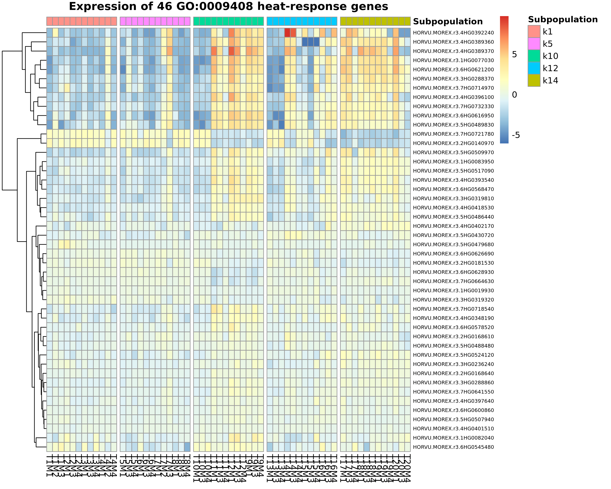
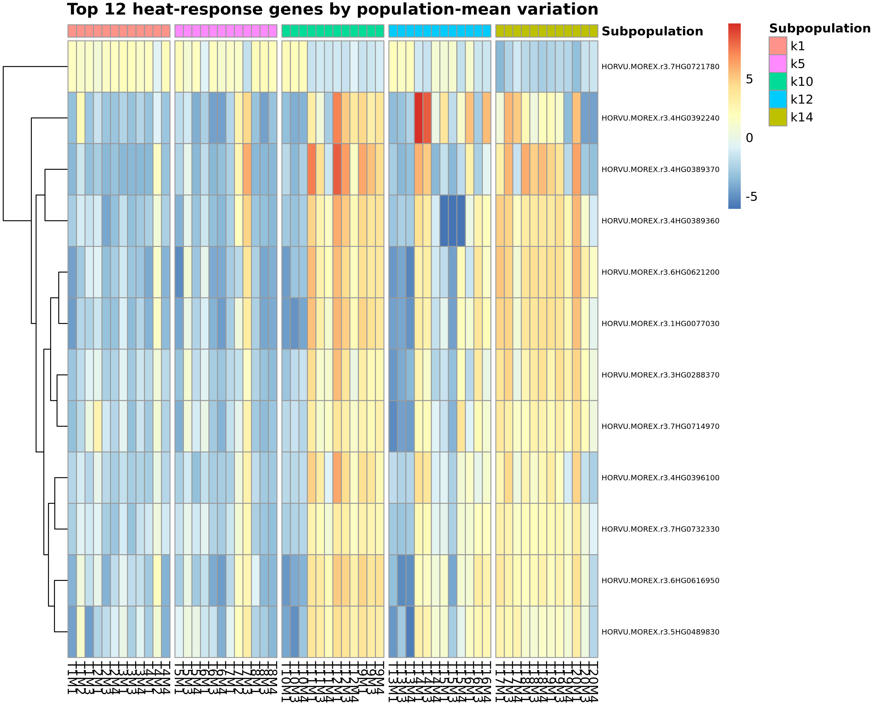
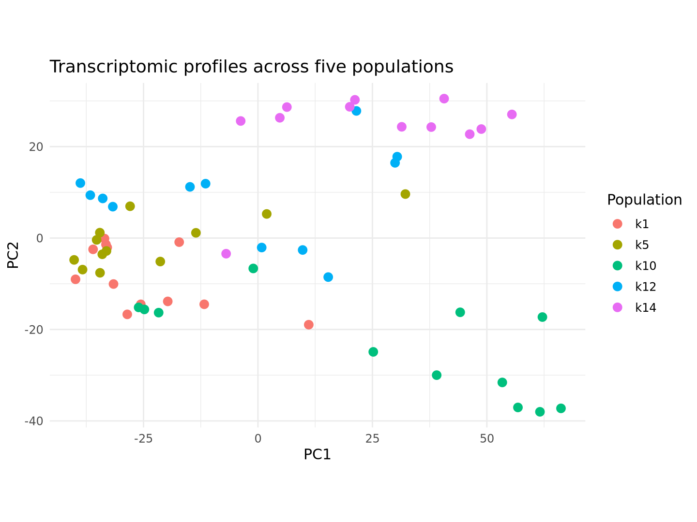
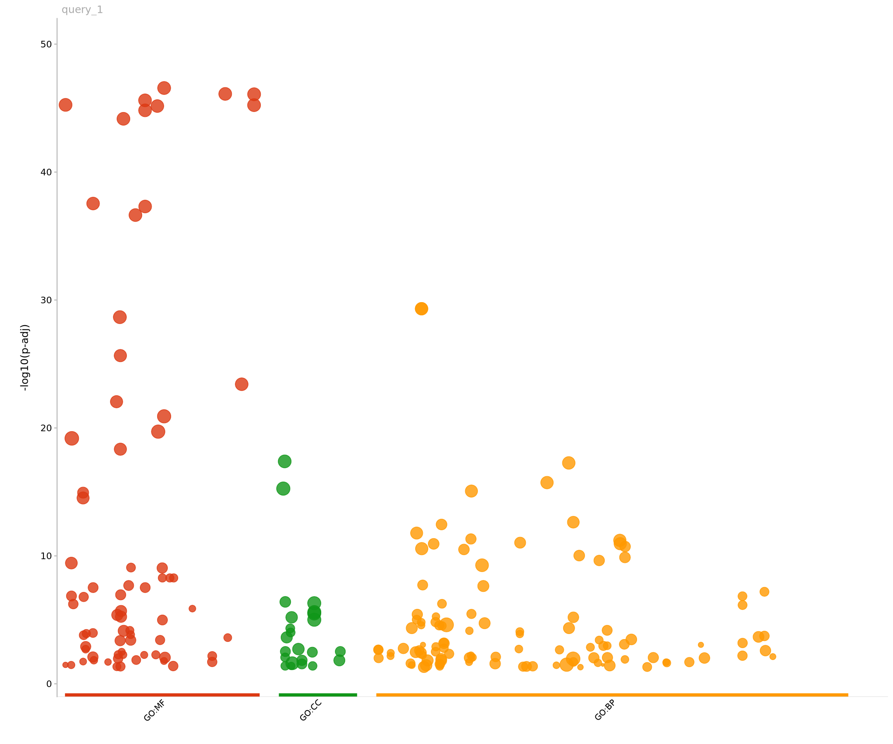

# Transcriptomic fingerprints across five Mediterranean barley populations

This project analyzes barley RNA-seq data from 60 samples. Samples T1–T20
belong to five populations: `k1`, `k5`, `k10`, `k12`, and `k14`. The analysis
finds genes with different expression among populations and examines
heat-response genes.

## Pipeline scope and data availability

The protocol covers FASTQ quality control, Morex V3 transcript quantification,
gene-count generation, differential expression, GO enrichment, and
heat-response gene annotation.

The FASTQ files are intended for release through the European Nucleotide
Archive (ENA). Their public accession and download link are under embargo and
will be added here after release. The sample manifest and QC reports are
available in this repository. The reference is Morex V3 from IPK Gatersleben.

The repository includes individual R scripts and commands for each pipeline
step. Large inputs and generated outputs remain in the local repository but
are excluded from Git.

## Repository structure

```text
transcriptomic-fingerprints-five-mediterranean-populations/
├── README.md
├── .gitignore
├── envs/
│   ├── rnaseq.yml
│   ├── deseq2.yml
│   └── conda-linux-64.lock
├── data/
│   ├── raw/                                    # paired FASTQ inputs
│   ├── processed/fastp/                        # cleaned paired reads
│   ├── input/kallisto.merged.gene_counts.tsv
│   └── metadata/                               # sample lists and QC summary
├── references/
│   ├── MorexV3.fa
│   ├── MorexV3.gff3
│   ├── MorexV3.transcripts.fa
│   ├── MorexV3.gtf
│   ├── MorexV3.idx
│   ├── MorexV3_tx2gene.tsv
│   └── BARLEX_MorexV3_annotations.tsv
├── scripts/
│   ├── 01_deseq2_populations.R
│   ├── 02_go_enrichment.R
│   ├── 03_heat_stress_and_annotation.R
│   └── 04_population_tpm_heat_response.py
├── results/
│   ├── upstream/
│   │   ├── fastp/                              # fastp reports
│   │   ├── fastqc/raw/                         # raw-read QC reports
│   │   ├── fastqc/trim/                        # cleaned-read QC reports
│   │   └── kallisto/                           # per-sample abundance results
│   ├── 01_deseq2/
│   ├── 02_go_enrichment/
│   ├── 03_heat_stress/
│   └── 04_tpm_leaf_baseline/
│       ├── top12_gene_sample_tpm.csv
│       ├── top12_gene_population_tpm_summary.csv
│       └── plots/                              # one plot per gene
└── docs/
    └── figures/
```

All 60 raw and cleaned FASTQ pairs, Morex V3 reference files, QC reports,
Kallisto results, and downstream results are available locally. Large files
are symlinks or are ignored by Git.

## Samples

The sample sheet lists the sample names and population assignments.

| Population | Genotypes | Samples |
|---|---|---:|
| k1 | T1–T4 | 12 |
| k5 | T5–T8 | 12 |
| k10 | T9–T12 | 12 |
| k12 | T13–T16 | 12 |
| k14 | T17–T20 | 12 |

The sample IDs and group labels are listed in
[`data/metadata/samples.csv`](data/metadata/samples.csv).

## Raw FASTQ inputs and sample mapping

The paired-end Illumina libraries are listed in
[`data/metadata/fastq_manifest.csv`](data/metadata/fastq_manifest.csv), with
sample ID, population, library strandedness, and the paired read filenames.
Each sample has two 150-cycle reads. The libraries are reverse stranded. Use
the manifest to match FASTQ file names to samples.

## FASTQ quality control and preparation

`fastp` cleans each read pair and writes JSON and HTML reports. The reports
cover all 60 samples. A per-sample summary is in
[`data/metadata/fastp_qc_summary.csv`](data/metadata/fastp_qc_summary.csv).
`fastp` 1.3.6 reports read counts, quality, adapter trimming, and filtering.
The options used were:

```text
-q 30 -u 15 -y -g -Y 10 -l 100 -b 150 -B 150
```

These settings trim poly-G tails and adapters, filter low-quality and
low-complexity reads, discard reads shorter than 100 bases, and cap read
length at 150 bases. The HTML and JSON reports show the QC results.

Across the 60 libraries, the reports record 1,891,663,404 input read pairs
and 1,578,532,879 retained pairs (83.45% overall). Mean per-library Q30
base fractions changed from 94.86% to 98.65% for read 1 and from 93.58% to
98.42% for read 2.

FastQC 0.12.1 reports for raw and cleaned reads are in
`results/upstream/fastqc/raw/` and `results/upstream/fastqc/trim/`.

Run these commands once per row in `data/metadata/fastq_manifest.csv`. For
sample `T1M1`:

```bash
sample=T1M1
R1=Unknown_CU317-001T0001_1.fq.gz
R2=Unknown_CU317-001T0001_2.fq.gz
mkdir -p data/processed/fastp results/upstream/fastp
fastp \
  -i "data/raw/${R1}" -I "data/raw/${R2}" \
  -o "data/processed/fastp/${sample}_R1.fastq.gz" \
  -O "data/processed/fastp/${sample}_R2.fastq.gz" \
  --html "results/upstream/fastp/${sample}.fastp.html" \
  --json "results/upstream/fastp/${sample}.fastp.json" \
  -q 30 -u 15 -y -g -Y 10 -l 100 -b 150 -B 150
```

Run FastQC on the raw and cleaned reads:

```bash
mkdir -p results/upstream/fastqc/raw results/upstream/fastqc/trim
fastqc --threads 12 --outdir results/upstream/fastqc/raw \
  "data/raw/${R1}" "data/raw/${R2}"
fastqc --threads 12 --outdir results/upstream/fastqc/trim \
  "data/processed/fastp/${sample}_R1.fastq.gz" \
  "data/processed/fastp/${sample}_R2.fastq.gz"
```

Check the FastQC reports before quantification.

## Reference and Kallisto quantification

Use the Morex V3 barley reference genome and gene annotation released by
[IPK Gatersleben](https://doi.org/10.5447/ipk/2021/3). The release,
“Pseudomolecules and annotation of the third version of the reference genome
sequence assembly of barley cv. Morex [Morex V3],” provides genomic
pseudomolecules in FASTA format and structural gene models in GFF3 format.
Download the genome FASTA and gene annotation from this release and record the
release DOI with the analysis:

```text
references/MorexV3.fa
references/MorexV3.gff3
```

Prepare a GTF and transcript FASTA that are both derived from the same
Morex V3 GFF3/FASTA release. If the release does not provide a transcript
FASTA directly, extract transcript sequences and convert the annotation with
`gffread`. Build the Kallisto index once from that transcript FASTA. The index
and transcript-to-gene relationships must come from the same reference
release. Kallisto 0.52.0 quantifies the cleaned reads with `--rf-stranded`, six
threads, and zero bootstrap replicates. The reference, transcriptome, index, and
transcript-to-gene map used for this analysis are in `references/`.

Example reference preparation and index commands:

```bash
gffread -T references/MorexV3.gff3 \
  -o references/MorexV3.gtf
gffread -w references/MorexV3.transcripts.fa \
  -g references/MorexV3.fa references/MorexV3.gff3
kallisto index -i references/MorexV3.idx \
  references/MorexV3.transcripts.fa
```

Pin the `gffread` version used for this conversion in the record of any
reproduction. Use the resulting GTF to map transcript estimates back to genes.

Run the quantification once per sample using the paired fastp outputs:

```bash
mkdir -p results/upstream/kallisto
kallisto quant \
  --threads 6 \
  --index references/MorexV3.idx \
  --gtf references/MorexV3.gtf \
  --rf-stranded \
  -o "results/upstream/kallisto/${sample}" \
  "data/processed/fastp/${sample}_R1.fastq.gz" \
  "data/processed/fastp/${sample}_R2.fastq.gz"
```

The run records 83,990 Kallisto targets and a 31-base k-mer. Across the 60
libraries, weighted pseudoalignment was 45.23% (per-library values
ranged from 43.4% to 50.8%). Per-sample `run_info.json` files record the
pseudoaligned read counts and command.

Kallisto writes per-sample transcript abundance estimates. These were merged
and summarized by gene ID into
`kallisto.merged.gene_counts.tsv`, with `gene_id` and `gene_name` columns and
60 sample columns. That matrix contains 81,687 gene rows. The DESeq2 analysis
rounds estimated counts to integers before modeling; it does not use TPM as
DESeq2 count input.

### Gene-count matrix and annotation resources

The matrix `data/input/kallisto.merged.gene_counts.tsv` is produced by merging
the Kallisto per-sample estimated counts and summarizing transcript estimates
to gene IDs using the matching transcript-to-gene map. Preserve gene IDs and
sample names as columns in the matrix. The committed matrix checksum
identifies the exact input used for the reported downstream results.

The independently required BARLEX table is staged at
`references/BARLEX_MorexV3_annotations.tsv`. It supplies Morex V3 gene
descriptions, Pfam, and InterPro fields to supplement online gene annotation.
Use the Morex V3 genome/GFF3 from the IPK release for read quantification, and
the BARLEX table as a separate functional annotation resource when describing
the candidate genes.

| Input | SHA-256 |
|---|---|
| `kallisto.merged.gene_counts.tsv` (60 samples) | `dfd94f50cfe070009f8971d38d2ed2c8718d14dcf8a075e675f26b5cdf7e2108` |
| `BARLEX_MorexV3_annotations.tsv` | `5f25fcfcb2d69346fdfa6be80dbc0cc790de3cad8f2b58cc53bb46115d9e9275` |
| `samples.csv` | `b1004640c8be6ef79abd7aa0052b8c836e3be1d62ceec2d106aeab6a5f371f35` |
| `fastq_manifest.csv` | `8dd97c18544044b1d03cb8cfc4d4088d17393d1fd9598a4ca743f4d8835f662c` |
| `fastp_qc_summary.csv` | `cf5754c2d5176af4d763f0e3059b785662e84b4afbbf9fbade333b9867dafd9f` |
| `heat_stress_gene_ids.csv` | `42218f0c0d38fafccba2ae40e6c7a3d6ca333864e1f024252bdcec5e123f6a88` |

Verify the matrix and annotation files with:

```bash
echo 'dfd94f50cfe070009f8971d38d2ed2c8718d14dcf8a075e675f26b5cdf7e2108  data/input/kallisto.merged.gene_counts.tsv' | sha256sum --check
echo '5f25fcfcb2d69346fdfa6be80dbc0cc790de3cad8f2b58cc53bb46115d9e9275  references/BARLEX_MorexV3_annotations.tsv' | sha256sum --check
```

Large input files and generated results are ignored by Git. The ENA accession
will be added after the archive release.

## Software and versions

Versions were taken from the per-sample quantification reports and the active
analysis environment:

| Program/package | Version |
|---|---:|
| FastQC (read quality reports) | 0.12.1 |
| fastp (paired-read filtering and QC) | 1.3.6 |
| Kallisto (transcriptome pseudoalignment and quantification) | 0.52.0 |
| R | 4.5.3 |
| DESeq2 | 1.50.2 |
| ggplot2 | 4.0.3 |
| pheatmap | 1.0.13 |
| gprofiler2 | 0.2.4 |
| gffread (transcript FASTA/GTF preparation) | 0.12.9 (protocol environment) |
| seqtk | not required by this protocol |

The R package versions are pinned by the downstream Conda environment files.
`envs/deseq2.yml` specifies direct R dependencies; the accompanying Linux
x86-64 explicit lock records resolved packages for exact recreation on that
platform. `envs/rnaseq.yml` pins FastQC, fastp, gffread, and Kallisto for upstream read
processing and quantification. The software versions are recorded for
the analyzed reads; gffread 0.12.9 is the version pinned in this protocol for
reference preparation. The reference files and Kallisto index are derived
from the cited Morex V3 release.

Create the upstream tools environment with:

```bash
conda env create --file envs/rnaseq.yml
conda activate barley-rnaseq-upstream
fastp --version
fastqc --version
kallisto version
```

Kallisto indexing requires a transcript FASTA and transcript-to-gene
annotation. Use the transcript sequences and gene identifiers derived from
the same Morex V3 GFF3. The upstream environment pins `gffread` for transcript
extraction. For a different operating system, solve each YAML separately and
retain platform-specific locks.

Create and activate the environment:

```bash
conda create --name five-populations-deseq2 --file envs/conda-linux-64.lock
conda activate five-populations-deseq2
```

The workflow requires R packages `DESeq2`, `ggplot2`, `pheatmap`, and
`gprofiler2`. g:Profiler is an online service: enrichment and gene conversion
require network access, and results may change as its database is updated.
Every returned table and the query timestamp are saved under
`results/02_go_enrichment/` or `results/03_heat_stress/`.

## Step-by-step analysis protocol

Perform the upstream steps in order: run `fastp`, prepare the Morex V3
transcript reference, run Kallisto, and combine gene counts.
Then run the three R scripts and the Python script below, one at a time. The
commands use the project-relative paths shown in the repository structure.

### Prepare the gene-count matrix

For each Kallisto `abundance.tsv`, use
`references/MorexV3_tx2gene.tsv` to map transcript IDs to gene IDs. Sum
`est_counts` for each gene and combine the samples listed in
`data/metadata/samples.csv`. Write
`data/input/kallisto.merged.gene_counts.tsv` with `gene_id`, `gene_name`, and
one column per sample. Keep unrounded counts; Script 1 rounds them before
model fitting. Verify the matrix checksum below.

### Run the analysis scripts separately

Run each command from the repository root with the
`five-populations-deseq2` environment active. There is no combined runner.

#### Script 1 — differential expression and exploratory plots

```bash
Rscript scripts/01_deseq2_populations.R
```

Validates the sample sheet, population labels, count values, and exact match
between the 60 declared sample IDs and matrix columns. It rounds the estimated
counts, fits the population omnibus DESeq2 likelihood-ratio test and all ten
pairwise Wald contrasts, calculates VST values, and produces PCA and heatmaps.
Outputs are written to `results/01_deseq2/`. Check the analysis and pairwise
summary tables and confirm that the significant-gene file exists before the
GO step.

#### Script 2 — GO enrichment

```bash
Rscript scripts/02_go_enrichment.R
```

Uses the significant omnibus genes from Script 1 as the query to g:Profiler
for barley (`hvulgare`). It saves the complete enrichment table, plot,
GO:0009408 intersection, term summary, and query metadata under
`results/02_go_enrichment/`. It requires an internet connection. Check the
term summary and query metadata before running annotation; the online database
can change over time.

#### Script 3 — heat-response gene annotation

```bash
Rscript scripts/03_heat_stress_and_annotation.R
```

Uses the committed 46-gene GO:0009408 list and the top-12 variation ranking
from Script 1. It retrieves barley ID conversions and descriptions from
g:Profiler, joins BARLEX description/Pfam/InterPro by exact gene ID, and
retains all 46 candidates. It requires internet access and
`references/BARLEX_MorexV3_annotations.tsv`. Outputs and annotation coverage
summaries are written to `results/03_heat_stress/`.

#### Script 4 — population TPM for the top 12 heat-response genes

```bash
python3 scripts/04_population_tpm_heat_response.py
```

The script reads the top-12 gene list, sample sheet, transcript-to-gene map,
and Kallisto `abundance.tsv` files. It sums transcript TPM values for each
gene in each sample. It writes one row per gene and sample to
`results/04_tpm_leaf_baseline/top12_gene_sample_tpm.csv`.

It also summarizes each gene within each population. The summary contains the
sample count, mean, standard deviation, and median TPM in
`top12_gene_population_tpm_summary.csv`. The standard deviation is the sample
standard deviation. It saves one plot per gene in `plots/`. The x-axis groups
replicates by genotype (T1, T2, and so on); each dot is labeled with its M
replicate. Background bands and point colors show populations. The horizontal
line marks the population median. The y-axis is linear TPM with zero at the
bottom. Python and Matplotlib are required.

## Analysis logic and why each step is used

1. **Model population-level expression differences.** Round Kallisto estimated
   counts to integers and fit a DESeq2 negative-binomial model with design
   `~ subpopulation`. The likelihood-ratio test compares that model with
   `~ 1`, testing whether expression differs anywhere among the five
   populations; it does not answer which pair differs. Benjamini–Hochberg
   adjusted p-values control the false discovery rate. A separate Wald model
   supplies all ten population-pair contrasts for follow-up.
2. **Visualize global expression.** Apply DESeq2's variance-stabilizing
   transformation to make expression patterns more comparable across the
   count range. Use those transformed values for PCA and heatmaps. The top-gene
   heatmap uses the most significant omnibus genes and centers each gene across
   samples to emphasize relative patterns, not absolute expression.
3. **Perform functional enrichment on the population-associated genes.**
   Query the omnibus significant-gene IDs against g:Profiler's barley
   (`hvulgare`) annotations. Enrichment asks whether a biological annotation
   appears more often in the significant set than expected; it does not show
   that a treatment caused the expression change.
4. **Focus interpretation on heat response after enrichment.** GO:0009408,
   “response to heat,” was significant in the barley enrichment result
   (adjusted p-value 0.02735), with 46 intersecting genes. Those 46 IDs are
   recorded in `data/metadata/heat_stress_gene_ids.csv`. This is a
   post-enrichment biological focus, not a filter applied to reads or to the
   initial DESeq2 test. It narrows interpretation to a relevant
   process while preserving the all-gene differential-expression and
   enrichment results. The 12 focused genes are ranked reproducibly by the
   standard deviation of each gene's five population-mean VST expression
   values; they are not selected by subjective inspection of the heatmap.
5. **Use two complementary annotation resources.** g:Profiler is the source
   of GO enrichment and provides barley ID conversion and descriptions.
   BARLEX provides Morex V3 descriptions, Pfam, and InterPro. The script uses
   BARLEX when g:Profiler has no description.
6. **Retain and report all candidates.** Join annotations by exact gene ID,
   preserve all 46 genes, and record genes without a description rather than
   silently dropping them. Save the focused top-12 table, figures, complete
   statistical/enrichment outputs, summaries, session information, and logs
   under their result folders.
7. **Summarize expression of the top 12 genes.** Sum transcript TPM values by
   gene for every sample, then calculate mean, standard deviation, and median
   within each population. Keep the sample-level table so the summary can be
   checked and replotted.

## Reported analysis results

The DESeq2 LRT identified 20,306 genes with adjusted p-value < 0.05 from
53,244 genes with testable p-values; 34,175 genes had a non-missing adjusted
p-value after independent filtering. The input matrix contained 81,687 gene
rows. Pairwise Wald contrasts produced the following significant-gene counts:

| Contrast | Significant genes |
|---|---:|
| k5 vs k1 | 2,830 |
| k10 vs k1 | 11,351 |
| k12 vs k1 | 4,016 |
| k14 vs k1 | 9,754 |
| k10 vs k5 | 12,963 |
| k12 vs k5 | 3,504 |
| k14 vs k5 | 9,407 |
| k12 vs k10 | 9,102 |
| k14 vs k10 | 7,976 |
| k14 vs k12 | 5,343 |

These are DESeq2 results from the population model, not claims of heat
treatment effects. The live barley g:Profiler query returned 207 significant
terms; GO:0009408 (“response to heat”) had an adjusted p-value of 0.02735 and
an intersection of 46 genes. All 46 exactly match the versioned gene set. The
service reported 7,327 mapped query genes for enrichment from the 20,306 DESeq2
IDs. The query timestamp and full response are saved with the run; the full
response is Git-ignored because of its size.

## Results and figures

Results are grouped by analysis step:

- `results/01_deseq2/`: omnibus and pairwise DESeq2 tables, contrast summary,
  PCA, heat-response and top-gene heatmaps, the reproducible top-12 ranking,
  model diagnostics, and R session details.
- `results/02_go_enrichment/`: complete barley GO enrichment, highlighted
  response-to-heat term, query details, and heat-gene intersection.
- `results/03_heat_stress/`: 46- and 12-gene annotation tables, annotation
  coverage summaries, and a record of genes without descriptions.
- `results/04_tpm_leaf_baseline/`: sample-level gene TPMs and population
  summaries and one plot per gene for the top 12 heat-response genes.
- `docs/figures/`: small PNG report figures embedded in this README.

Large result tables are local and ignored by Git. Compact summaries, scripts,
and report images are tracked. Key result tables are
[`analysis_summary.csv`](results/01_deseq2/analysis_summary.csv),
[`pairwise_contrast_summary.csv`](results/01_deseq2/pairwise_contrast_summary.csv),
[`heat_response_top12_gene_ids.csv`](results/01_deseq2/heat_response_top12_gene_ids.csv),
[`heat_response_46_annotations.csv`](results/03_heat_stress/heat_response_46_annotations.csv),
[`heat_response_top12_annotations.csv`](results/03_heat_stress/heat_response_top12_annotations.csv),
[`top12_gene_sample_tpm.csv`](results/04_tpm_leaf_baseline/top12_gene_sample_tpm.csv),
and [`top12_gene_population_tpm_summary.csv`](results/04_tpm_leaf_baseline/top12_gene_population_tpm_summary.csv).
g:Profiler and BARLEX supplied descriptions for all 46 genes.
The top-12 TPM output contains 720 gene-sample values and 60 gene-population
summaries. The BARLEX leaf baseline comparison is not part of this step.

### Expression heatmap: 46 heat-response genes



Columns are samples ordered by population; rows are hierarchically clustered
genes. Color represents per-gene centered DESeq2 VST expression.

### Expression heatmap: 12 reproducibly ranked candidates



The focused set is selected by descending variation among the five population
mean expression values.

### Principal component analysis



The figure is regenerated from the VST matrix by
`scripts/01_deseq2_populations.R`.

### Barley GO enrichment



The full g:Profiler response and a second plot highlighting GO:0009408 are
written under `results/02_go_enrichment/`.

## Output interpretation and limitations

The analysis measures association with population; it does not show that heat
stress caused expression differences. g:Profiler annotations can change over
time. BARLEX annotations depend on the supplied reference release.
