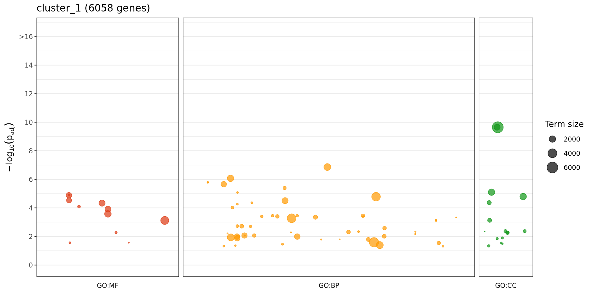
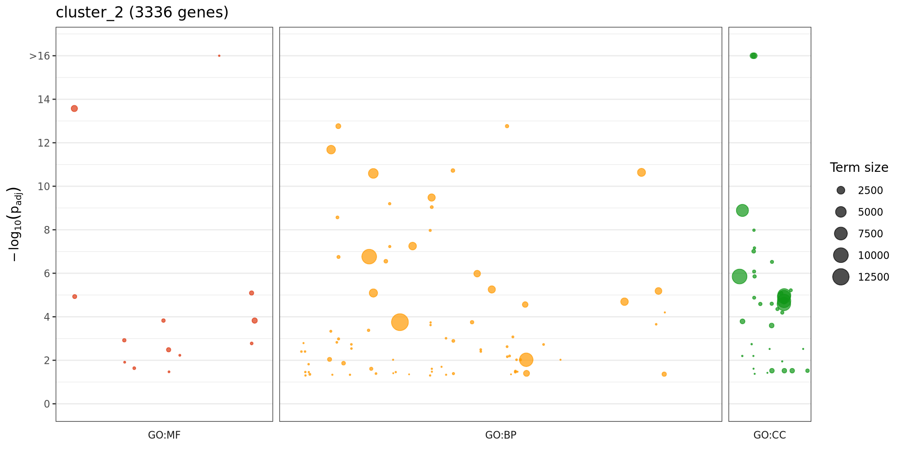
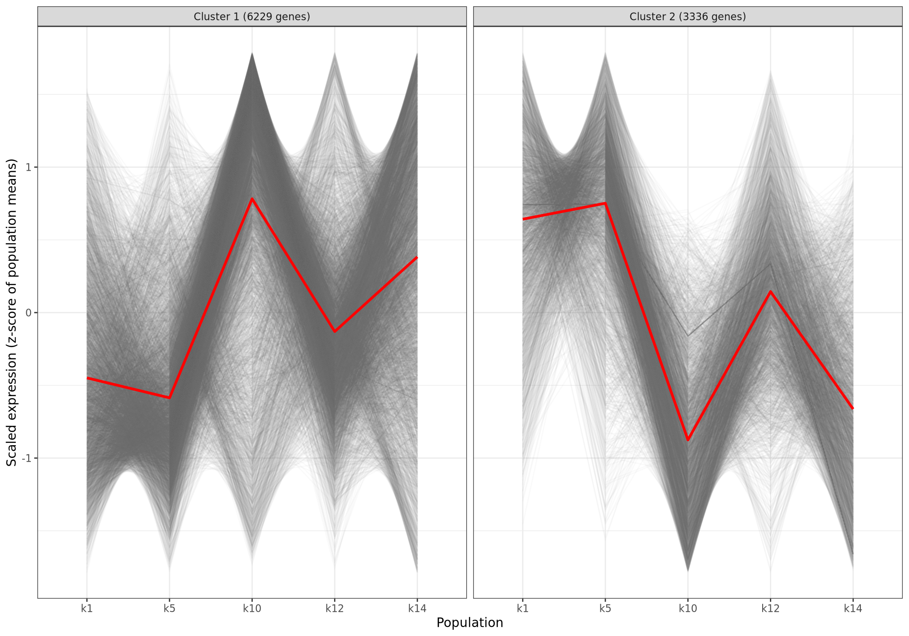
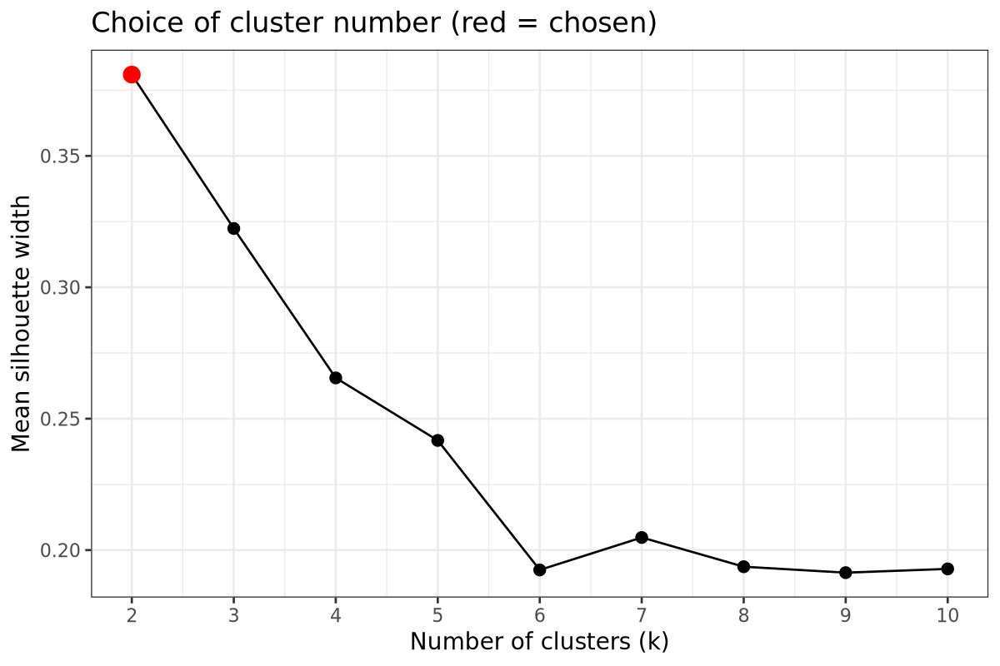

# Part B — GO enrichment by expression cluster

## Index of figures

| Figure | Content |
|---|---|
| [`cluster_1_GO.png`](#cluster_1_gopng) | GO enrichment of cluster 1. |
| [`cluster_2_GO.png`](#cluster_2_gopng) | GO enrichment of cluster 2. |
| [`cluster_patterns.png`](#cluster_patternspng) | Each grey line is one gene's scaled expression across the five populations; the red line is the cluster average. |
| [`silhouette.png`](#silhouettepng) | Mean silhouette width for 2–10 clusters. |

## Index of tables

| Table | Rows | Columns |
|---|---:|---:|
| [`cluster_1_GO_significant.tsv`](#cluster_1_go_significanttsv) | 78 | 10 |
| [`cluster_2_GO_significant.tsv`](#cluster_2_go_significanttsv) | 101 | 10 |
| [`cluster_assignment.tsv`](#cluster_assignmenttsv) | 10,497 | 7 |
| [`silhouette.tsv`](#silhouettetsv) | 9 | 2 |

## Figures

### cluster_1_GO.png

GO enrichment of cluster 1. Same layout as g:Profiler. Each dot is one significant GO term (adjusted p < 0.05). Panels: GO:MF, GO:BP and GO:CC, with width proportional to the terms tested. Height: -log10(adjusted p), capped at 16. Dot size: background genes in the term.

### cluster_2_GO.png

GO enrichment of cluster 2. Same layout as g:Profiler. Each dot is one significant GO term (adjusted p < 0.05). Panels: GO:MF, GO:BP and GO:CC, with width proportional to the terms tested. Height: -log10(adjusted p), capped at 16. Dot size: background genes in the term.

### cluster_patterns.png

Each grey line is one gene's scaled expression across the five populations; the red line is the cluster average. Values above 0 are higher than the gene's average.

### silhouette.png

Mean silhouette width for 2–10 clusters. The red dot is the number used.

## Tables

First 5 rows of each table. Values are rounded and long text is cut for display; at most 8 columns are shown. The files hold the full values.

### cluster_1_GO_significant.tsv

Significant GO terms of this group (adjusted p < 0.05): namespace, term, term size, group genes in the term, annotated genes in the group and background, p, adjusted p and gene IDs.

[`cluster_1_GO_significant.tsv`](cluster_1_GO_significant.tsv): 78 rows, 10 columns.

All columns: `namespace`, `go_id`, `go_name`, `term_size`, `genes_in_term`, `list_annotated`, `universe_annotated`, `p_value`, `p_adj`, `genes`.

| namespace | go_id | go_name | term_size | genes_in_term | list_annotated | universe_annotated | p_value |
| --- | --- | --- | --- | --- | --- | --- | --- |
| biological_process | GO:0036211 | protein modification process | 2293 | 760 | 4261 | 15,565 | 2.362e-11 |
| biological_process | GO:0006796 | phosphate-containing compound metabolic process | 2026 | 673 | 4261 | 15,565 | 2.913e-10 |
| biological_process | GO:0002229 | defense response to oomycetes | 78 | 47 | 4261 | 15,565 | 1.12e-09 |
| biological_process | GO:0002239 | response to oomycetes | 80 | 48 | 4261 | 15,565 | 9.16e-10 |
| biological_process | GO:0006468 | protein phosphorylation | 1438 | 491 | 4261 | 15,565 | 1.877e-09 |

### cluster_2_GO_significant.tsv

Significant GO terms of this group (adjusted p < 0.05): namespace, term, term size, group genes in the term, annotated genes in the group and background, p, adjusted p and gene IDs.

[`cluster_2_GO_significant.tsv`](cluster_2_GO_significant.tsv): 101 rows, 10 columns.

All columns: `namespace`, `go_id`, `go_name`, `term_size`, `genes_in_term`, `list_annotated`, `universe_annotated`, `p_value`, `p_adj`, `genes`.

| namespace | go_id | go_name | term_size | genes_in_term | list_annotated | universe_annotated | p_value |
| --- | --- | --- | --- | --- | --- | --- | --- |
| biological_process | GO:0006139 | nucleobase-containing compound metabolic process | 3223 | 765 | 3036 | 15,565 | 1.351e-11 |
| biological_process | GO:0042254 | ribosome biogenesis | 340 | 119 | 3036 | 15,565 | 9.149e-12 |
| biological_process | GO:0090304 | nucleic acid metabolic process | 2730 | 658 | 3036 | 15,565 | 3.658e-11 |
| biological_process | GO:0009451 | RNA modification | 438 | 141 | 3036 | 15,565 | 1.175e-10 |
| biological_process | GO:0009657 | plastid organization | 138 | 59 | 3036 | 15,565 | 3.117e-10 |

### cluster_assignment.tsv

Cluster and z-scored population means of each omnibus DEG.

[`cluster_assignment.tsv`](cluster_assignment.tsv): 10,497 rows, 7 columns.

| gene_id | cluster | k1 | k5 | k10 | k12 | k14 |
| --- | --- | --- | --- | --- | --- | --- |
| HORVU.MOREX.r3.1HG0021100 | 1 | -1.103 | 0.6957 | -1.087 | 0.749 | 0.7456 |
| HORVU.MOREX.r3.7HG0717880 | 2 | -0.5315 | 1.784 | -0.3418 | -0.4818 | -0.4294 |
| HORVU.MOREX.r3.1HG0021110 | 1 | -1.111 | 0.8595 | -1.06 | 0.8007 | 0.5112 |
| HORVU.MOREX.r3.3HG0247960 | 2 | 0.9597 | 0.3801 | 0.8014 | -1.071 | -1.071 |
| HORVU.MOREX.r3.2HG0138060 | 1 | -0.6546 | -0.6546 | -0.6546 | 0.3551 | 1.609 |

### silhouette.tsv

Mean silhouette for 2–10 clusters.

[`silhouette.tsv`](silhouette.tsv): 9 rows, 2 columns.

| k | mean_silhouette |
| --- | --- |
| 2 | 0.3866 |
| 3 | 0.3315 |
| 4 | 0.2782 |
| 5 | 0.2239 |
| 6 | 0.2329 |
