# Part B — GO enrichment by pairwise comparison

## Index of figures

| Figure | Content |
|---|---|
| [`k10_vs_k1_up_in_k10_GO.png`](#k10_vs_k1_up_in_k10_gopng) | GO enrichment of k10 vs k1 DEGs (adjusted p < 0.05, |log2FC| ≥ 1) higher in k10. |
| [`k10_vs_k1_up_in_k1_GO.png`](#k10_vs_k1_up_in_k1_gopng) | GO enrichment of k10 vs k1 DEGs (adjusted p < 0.05, |log2FC| ≥ 1) higher in k1. |
| [`k10_vs_k5_up_in_k10_GO.png`](#k10_vs_k5_up_in_k10_gopng) | GO enrichment of k10 vs k5 DEGs (adjusted p < 0.05, |log2FC| ≥ 1) higher in k10. |
| [`k10_vs_k5_up_in_k5_GO.png`](#k10_vs_k5_up_in_k5_gopng) | GO enrichment of k10 vs k5 DEGs (adjusted p < 0.05, |log2FC| ≥ 1) higher in k5. |
| [`k12_vs_k10_up_in_k10_GO.png`](#k12_vs_k10_up_in_k10_gopng) | GO enrichment of k12 vs k10 DEGs (adjusted p < 0.05, |log2FC| ≥ 1) higher in k10. |
| [`k12_vs_k10_up_in_k12_GO.png`](#k12_vs_k10_up_in_k12_gopng) | GO enrichment of k12 vs k10 DEGs (adjusted p < 0.05, |log2FC| ≥ 1) higher in k12. |
| [`k12_vs_k1_up_in_k12_GO.png`](#k12_vs_k1_up_in_k12_gopng) | GO enrichment of k12 vs k1 DEGs (adjusted p < 0.05, |log2FC| ≥ 1) higher in k12. |
| [`k12_vs_k1_up_in_k1_GO.png`](#k12_vs_k1_up_in_k1_gopng) | GO enrichment of k12 vs k1 DEGs (adjusted p < 0.05, |log2FC| ≥ 1) higher in k1. |
| [`k12_vs_k5_up_in_k12_GO.png`](#k12_vs_k5_up_in_k12_gopng) | GO enrichment of k12 vs k5 DEGs (adjusted p < 0.05, |log2FC| ≥ 1) higher in k12. |
| [`k12_vs_k5_up_in_k5_GO.png`](#k12_vs_k5_up_in_k5_gopng) | GO enrichment of k12 vs k5 DEGs (adjusted p < 0.05, |log2FC| ≥ 1) higher in k5. |
| [`k14_vs_k10_up_in_k10_GO.png`](#k14_vs_k10_up_in_k10_gopng) | GO enrichment of k14 vs k10 DEGs (adjusted p < 0.05, |log2FC| ≥ 1) higher in k10. |
| [`k14_vs_k10_up_in_k14_GO.png`](#k14_vs_k10_up_in_k14_gopng) | GO enrichment of k14 vs k10 DEGs (adjusted p < 0.05, |log2FC| ≥ 1) higher in k14. |
| [`k14_vs_k12_up_in_k12_GO.png`](#k14_vs_k12_up_in_k12_gopng) | GO enrichment of k14 vs k12 DEGs (adjusted p < 0.05, |log2FC| ≥ 1) higher in k12. |
| [`k14_vs_k12_up_in_k14_GO.png`](#k14_vs_k12_up_in_k14_gopng) | GO enrichment of k14 vs k12 DEGs (adjusted p < 0.05, |log2FC| ≥ 1) higher in k14. |
| [`k14_vs_k1_up_in_k14_GO.png`](#k14_vs_k1_up_in_k14_gopng) | GO enrichment of k14 vs k1 DEGs (adjusted p < 0.05, |log2FC| ≥ 1) higher in k14. |
| [`k14_vs_k1_up_in_k1_GO.png`](#k14_vs_k1_up_in_k1_gopng) | GO enrichment of k14 vs k1 DEGs (adjusted p < 0.05, |log2FC| ≥ 1) higher in k1. |
| [`k14_vs_k5_up_in_k14_GO.png`](#k14_vs_k5_up_in_k14_gopng) | GO enrichment of k14 vs k5 DEGs (adjusted p < 0.05, |log2FC| ≥ 1) higher in k14. |
| [`k14_vs_k5_up_in_k5_GO.png`](#k14_vs_k5_up_in_k5_gopng) | GO enrichment of k14 vs k5 DEGs (adjusted p < 0.05, |log2FC| ≥ 1) higher in k5. |
| [`k5_vs_k1_up_in_k1_GO.png`](#k5_vs_k1_up_in_k1_gopng) | GO enrichment of k5 vs k1 DEGs (adjusted p < 0.05, |log2FC| ≥ 1) higher in k1. |
| [`k5_vs_k1_up_in_k5_GO.png`](#k5_vs_k1_up_in_k5_gopng) | GO enrichment of k5 vs k1 DEGs (adjusted p < 0.05, |log2FC| ≥ 1) higher in k5. |

## Index of tables

| Table | Rows | Columns |
|---|---:|---:|
| [`k10_vs_k1_up_in_k10_GO_significant.tsv`](#k10_vs_k1_up_in_k10_go_significanttsv) | 47 | 10 |
| [`k10_vs_k1_up_in_k1_GO_significant.tsv`](#k10_vs_k1_up_in_k1_go_significanttsv) | 11 | 10 |
| [`k10_vs_k5_up_in_k10_GO_significant.tsv`](#k10_vs_k5_up_in_k10_go_significanttsv) | 107 | 10 |
| [`k10_vs_k5_up_in_k5_GO_significant.tsv`](#k10_vs_k5_up_in_k5_go_significanttsv) | 86 | 10 |
| [`k12_vs_k10_up_in_k10_GO_significant.tsv`](#k12_vs_k10_up_in_k10_go_significanttsv) | 77 | 10 |
| [`k12_vs_k10_up_in_k12_GO_significant.tsv`](#k12_vs_k10_up_in_k12_go_significanttsv) | 7 | 10 |
| [`k12_vs_k1_up_in_k12_GO_significant.tsv`](#k12_vs_k1_up_in_k12_go_significanttsv) | 0 | 10 |
| [`k12_vs_k1_up_in_k1_GO_significant.tsv`](#k12_vs_k1_up_in_k1_go_significanttsv) | 0 | 10 |
| [`k12_vs_k5_up_in_k12_GO_significant.tsv`](#k12_vs_k5_up_in_k12_go_significanttsv) | 29 | 10 |
| [`k12_vs_k5_up_in_k5_GO_significant.tsv`](#k12_vs_k5_up_in_k5_go_significanttsv) | 0 | 10 |
| [`k14_vs_k10_up_in_k10_GO_significant.tsv`](#k14_vs_k10_up_in_k10_go_significanttsv) | 72 | 10 |
| [`k14_vs_k10_up_in_k14_GO_significant.tsv`](#k14_vs_k10_up_in_k14_go_significanttsv) | 1 | 10 |
| [`k14_vs_k12_up_in_k12_GO_significant.tsv`](#k14_vs_k12_up_in_k12_go_significanttsv) | 43 | 10 |
| [`k14_vs_k12_up_in_k14_GO_significant.tsv`](#k14_vs_k12_up_in_k14_go_significanttsv) | 0 | 10 |
| [`k14_vs_k1_up_in_k14_GO_significant.tsv`](#k14_vs_k1_up_in_k14_go_significanttsv) | 16 | 10 |
| [`k14_vs_k1_up_in_k1_GO_significant.tsv`](#k14_vs_k1_up_in_k1_go_significanttsv) | 26 | 10 |
| [`k14_vs_k5_up_in_k14_GO_significant.tsv`](#k14_vs_k5_up_in_k14_go_significanttsv) | 46 | 10 |
| [`k14_vs_k5_up_in_k5_GO_significant.tsv`](#k14_vs_k5_up_in_k5_go_significanttsv) | 33 | 10 |
| [`k5_vs_k1_up_in_k1_GO_significant.tsv`](#k5_vs_k1_up_in_k1_go_significanttsv) | 20 | 10 |
| [`k5_vs_k1_up_in_k5_GO_significant.tsv`](#k5_vs_k1_up_in_k5_go_significanttsv) | 0 | 10 |

## Figures

### k10_vs_k1_up_in_k10_GO.png

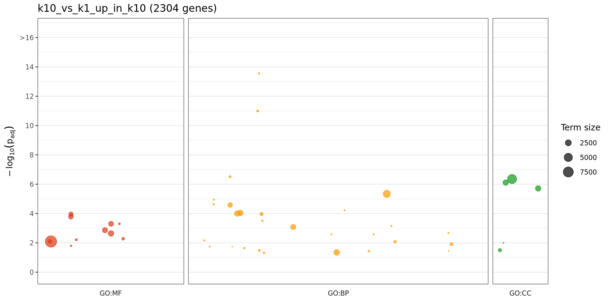

GO enrichment of k10 vs k1 DEGs (adjusted p < 0.05, |log2FC| ≥ 1) higher in k10. Same layout as g:Profiler. Each dot is one significant GO term (adjusted p < 0.05). Panels: GO:MF, GO:BP and GO:CC, with width proportional to the terms tested. Height: -log10(adjusted p), capped at 16. Dot size: background genes in the term.

### k10_vs_k1_up_in_k1_GO.png

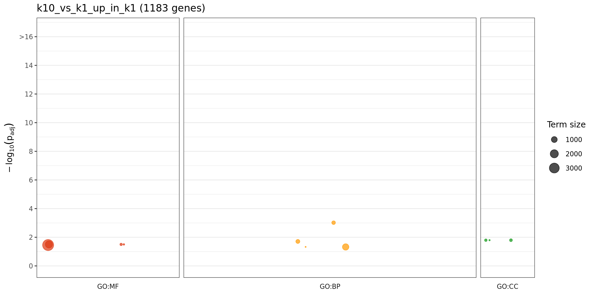

GO enrichment of k10 vs k1 DEGs (adjusted p < 0.05, |log2FC| ≥ 1) higher in k1. Same layout as g:Profiler. Each dot is one significant GO term (adjusted p < 0.05). Panels: GO:MF, GO:BP and GO:CC, with width proportional to the terms tested. Height: -log10(adjusted p), capped at 16. Dot size: background genes in the term.

### k10_vs_k5_up_in_k10_GO.png

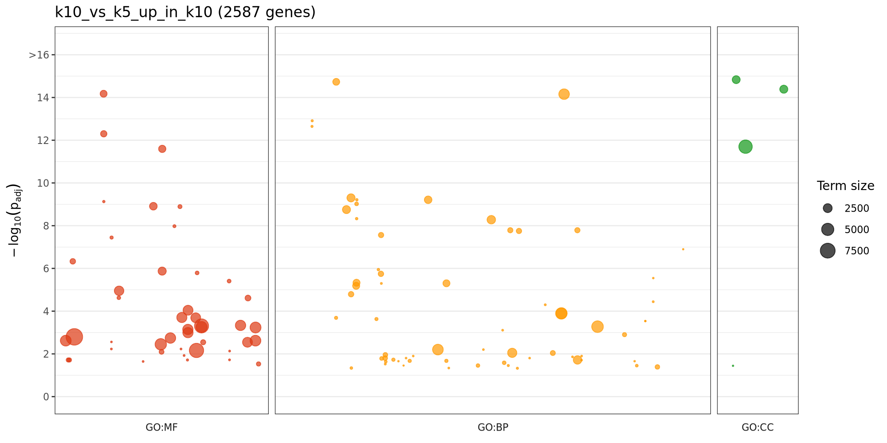

GO enrichment of k10 vs k5 DEGs (adjusted p < 0.05, |log2FC| ≥ 1) higher in k10. Same layout as g:Profiler. Each dot is one significant GO term (adjusted p < 0.05). Panels: GO:MF, GO:BP and GO:CC, with width proportional to the terms tested. Height: -log10(adjusted p), capped at 16. Dot size: background genes in the term.

### k10_vs_k5_up_in_k5_GO.png

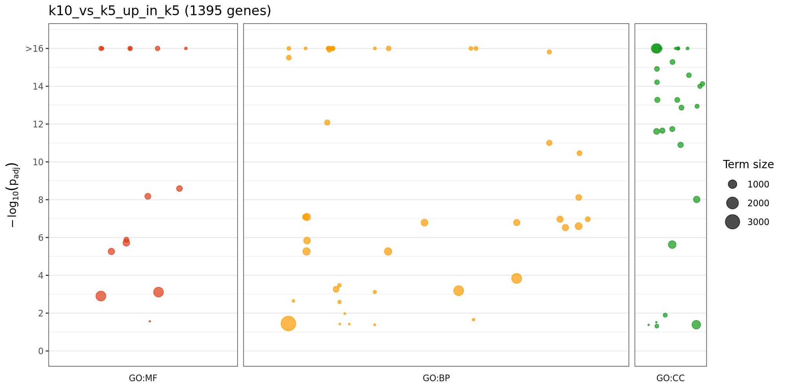

GO enrichment of k10 vs k5 DEGs (adjusted p < 0.05, |log2FC| ≥ 1) higher in k5. Same layout as g:Profiler. Each dot is one significant GO term (adjusted p < 0.05). Panels: GO:MF, GO:BP and GO:CC, with width proportional to the terms tested. Height: -log10(adjusted p), capped at 16. Dot size: background genes in the term.

### k12_vs_k10_up_in_k10_GO.png

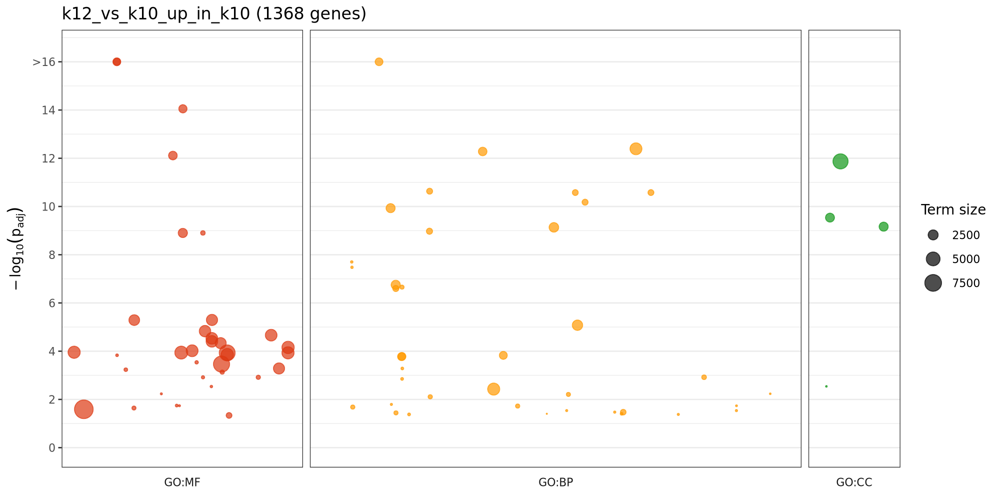

GO enrichment of k12 vs k10 DEGs (adjusted p < 0.05, |log2FC| ≥ 1) higher in k10. Same layout as g:Profiler. Each dot is one significant GO term (adjusted p < 0.05). Panels: GO:MF, GO:BP and GO:CC, with width proportional to the terms tested. Height: -log10(adjusted p), capped at 16. Dot size: background genes in the term.

### k12_vs_k10_up_in_k12_GO.png

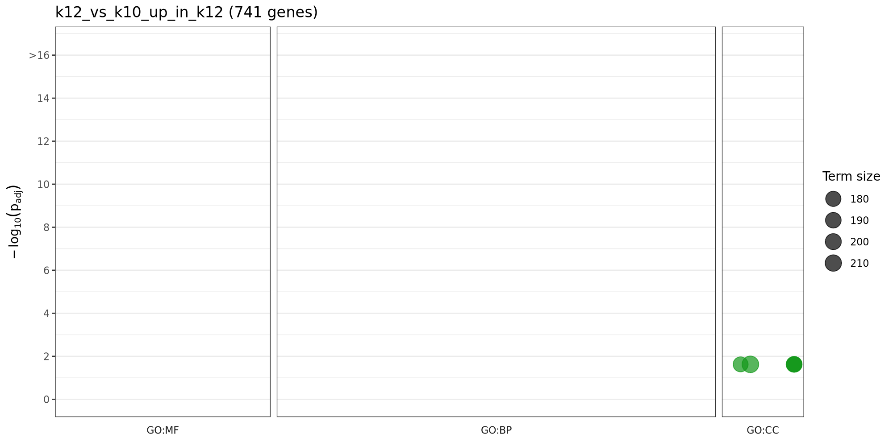

GO enrichment of k12 vs k10 DEGs (adjusted p < 0.05, |log2FC| ≥ 1) higher in k12. Same layout as g:Profiler. Each dot is one significant GO term (adjusted p < 0.05). Panels: GO:MF, GO:BP and GO:CC, with width proportional to the terms tested. Height: -log10(adjusted p), capped at 16. Dot size: background genes in the term.

### k12_vs_k1_up_in_k12_GO.png

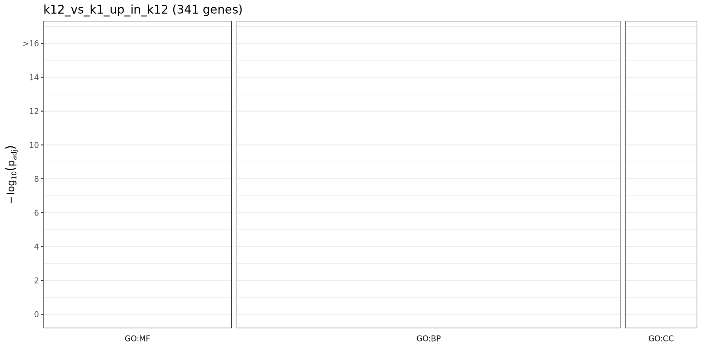

GO enrichment of k12 vs k1 DEGs (adjusted p < 0.05, |log2FC| ≥ 1) higher in k12. Same layout as g:Profiler. Each dot is one significant GO term (adjusted p < 0.05). Panels: GO:MF, GO:BP and GO:CC, with width proportional to the terms tested. Height: -log10(adjusted p), capped at 16. Dot size: background genes in the term.

### k12_vs_k1_up_in_k1_GO.png

GO enrichment of k12 vs k1 DEGs (adjusted p < 0.05, |log2FC| ≥ 1) higher in k1. Same layout as g:Profiler. Each dot is one significant GO term (adjusted p < 0.05). Panels: GO:MF, GO:BP and GO:CC, with width proportional to the terms tested. Height: -log10(adjusted p), capped at 16. Dot size: background genes in the term.

### k12_vs_k5_up_in_k12_GO.png

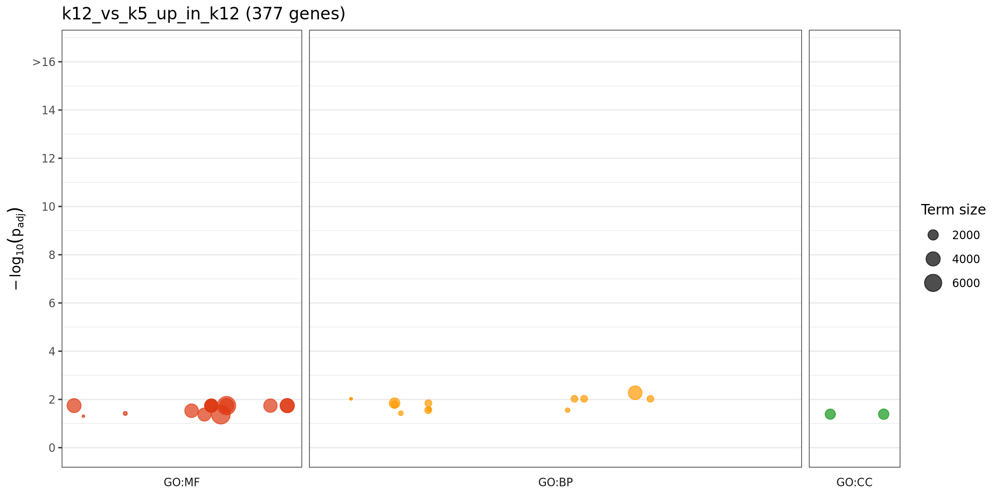

GO enrichment of k12 vs k5 DEGs (adjusted p < 0.05, |log2FC| ≥ 1) higher in k12. Same layout as g:Profiler. Each dot is one significant GO term (adjusted p < 0.05). Panels: GO:MF, GO:BP and GO:CC, with width proportional to the terms tested. Height: -log10(adjusted p), capped at 16. Dot size: background genes in the term.

### k12_vs_k5_up_in_k5_GO.png

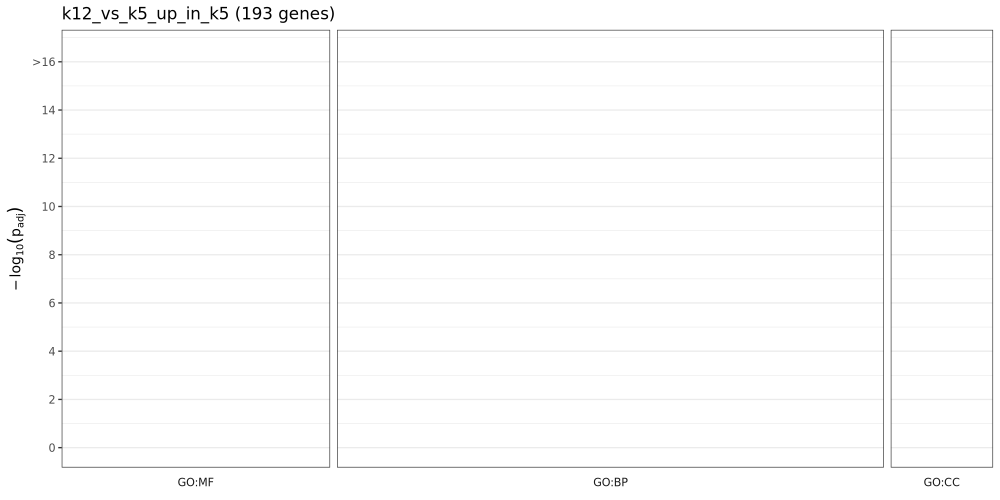

GO enrichment of k12 vs k5 DEGs (adjusted p < 0.05, |log2FC| ≥ 1) higher in k5. Same layout as g:Profiler. Each dot is one significant GO term (adjusted p < 0.05). Panels: GO:MF, GO:BP and GO:CC, with width proportional to the terms tested. Height: -log10(adjusted p), capped at 16. Dot size: background genes in the term.

### k14_vs_k10_up_in_k10_GO.png

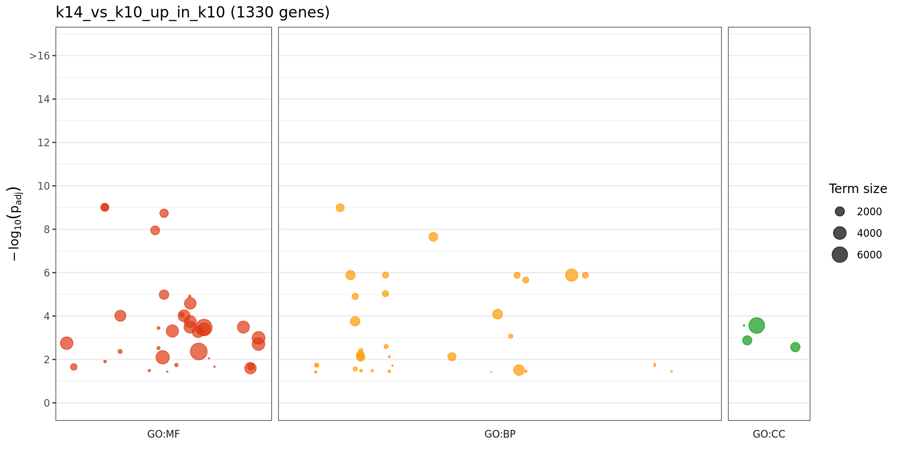

GO enrichment of k14 vs k10 DEGs (adjusted p < 0.05, |log2FC| ≥ 1) higher in k10. Same layout as g:Profiler. Each dot is one significant GO term (adjusted p < 0.05). Panels: GO:MF, GO:BP and GO:CC, with width proportional to the terms tested. Height: -log10(adjusted p), capped at 16. Dot size: background genes in the term.

### k14_vs_k10_up_in_k14_GO.png

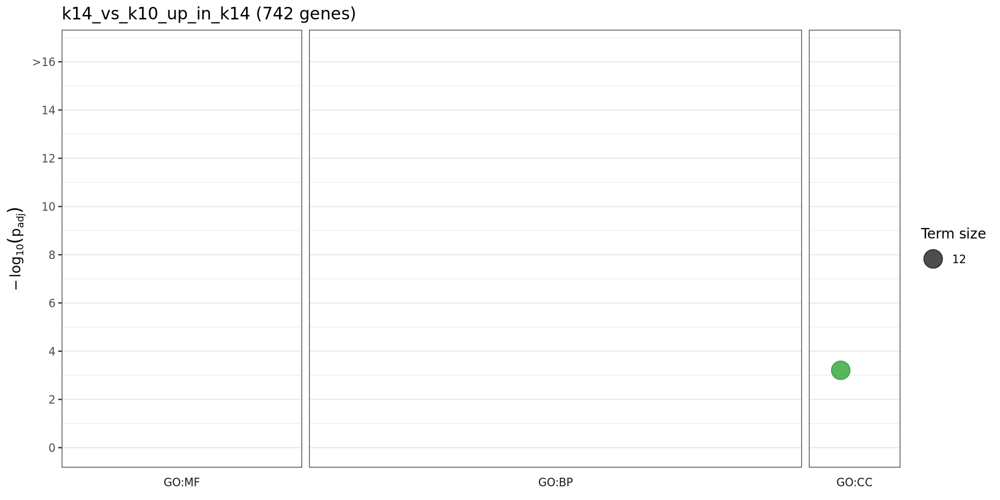

GO enrichment of k14 vs k10 DEGs (adjusted p < 0.05, |log2FC| ≥ 1) higher in k14. Same layout as g:Profiler. Each dot is one significant GO term (adjusted p < 0.05). Panels: GO:MF, GO:BP and GO:CC, with width proportional to the terms tested. Height: -log10(adjusted p), capped at 16. Dot size: background genes in the term.

### k14_vs_k12_up_in_k12_GO.png

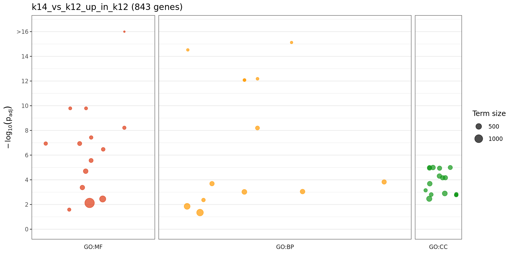

GO enrichment of k14 vs k12 DEGs (adjusted p < 0.05, |log2FC| ≥ 1) higher in k12. Same layout as g:Profiler. Each dot is one significant GO term (adjusted p < 0.05). Panels: GO:MF, GO:BP and GO:CC, with width proportional to the terms tested. Height: -log10(adjusted p), capped at 16. Dot size: background genes in the term.

### k14_vs_k12_up_in_k14_GO.png

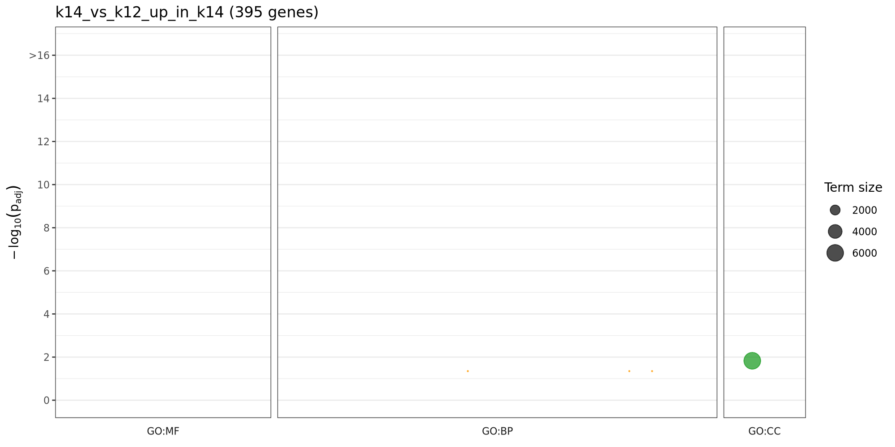

GO enrichment of k14 vs k12 DEGs (adjusted p < 0.05, |log2FC| ≥ 1) higher in k14. Same layout as g:Profiler. Each dot is one significant GO term (adjusted p < 0.05). Panels: GO:MF, GO:BP and GO:CC, with width proportional to the terms tested. Height: -log10(adjusted p), capped at 16. Dot size: background genes in the term.

### k14_vs_k1_up_in_k14_GO.png

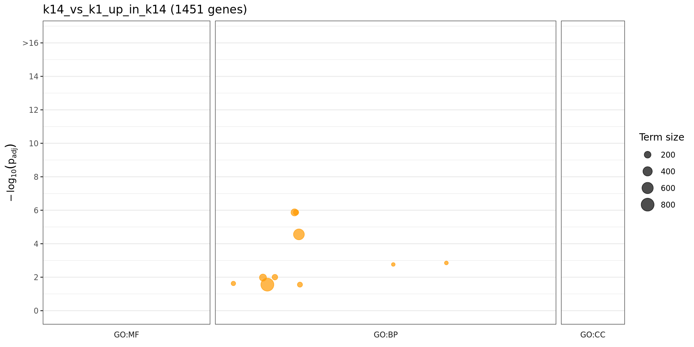

GO enrichment of k14 vs k1 DEGs (adjusted p < 0.05, |log2FC| ≥ 1) higher in k14. Same layout as g:Profiler. Each dot is one significant GO term (adjusted p < 0.05). Panels: GO:MF, GO:BP and GO:CC, with width proportional to the terms tested. Height: -log10(adjusted p), capped at 16. Dot size: background genes in the term.

### k14_vs_k1_up_in_k1_GO.png

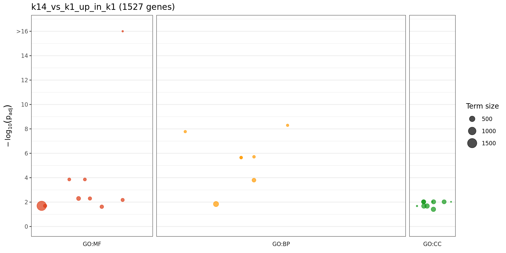

GO enrichment of k14 vs k1 DEGs (adjusted p < 0.05, |log2FC| ≥ 1) higher in k1. Same layout as g:Profiler. Each dot is one significant GO term (adjusted p < 0.05). Panels: GO:MF, GO:BP and GO:CC, with width proportional to the terms tested. Height: -log10(adjusted p), capped at 16. Dot size: background genes in the term.

### k14_vs_k5_up_in_k14_GO.png

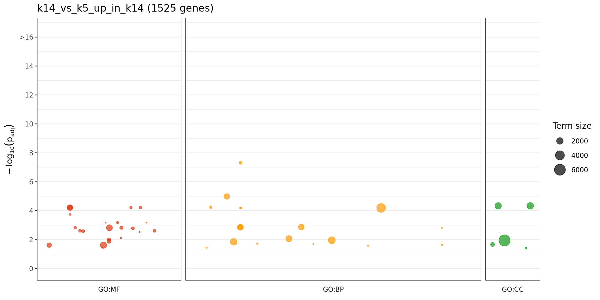

GO enrichment of k14 vs k5 DEGs (adjusted p < 0.05, |log2FC| ≥ 1) higher in k14. Same layout as g:Profiler. Each dot is one significant GO term (adjusted p < 0.05). Panels: GO:MF, GO:BP and GO:CC, with width proportional to the terms tested. Height: -log10(adjusted p), capped at 16. Dot size: background genes in the term.

### k14_vs_k5_up_in_k5_GO.png

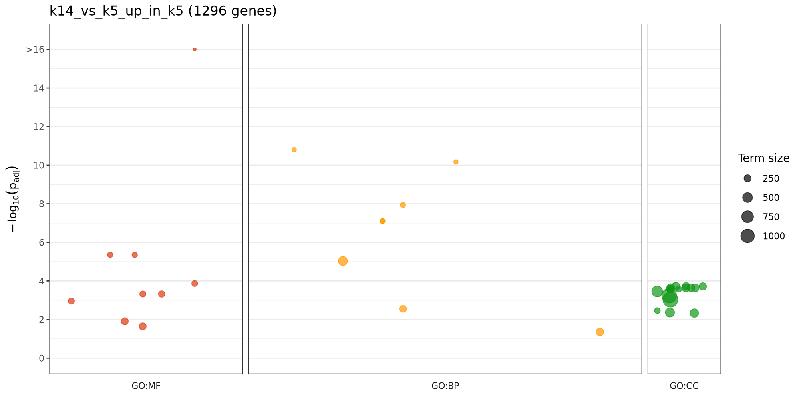

GO enrichment of k14 vs k5 DEGs (adjusted p < 0.05, |log2FC| ≥ 1) higher in k5. Same layout as g:Profiler. Each dot is one significant GO term (adjusted p < 0.05). Panels: GO:MF, GO:BP and GO:CC, with width proportional to the terms tested. Height: -log10(adjusted p), capped at 16. Dot size: background genes in the term.

### k5_vs_k1_up_in_k1_GO.png

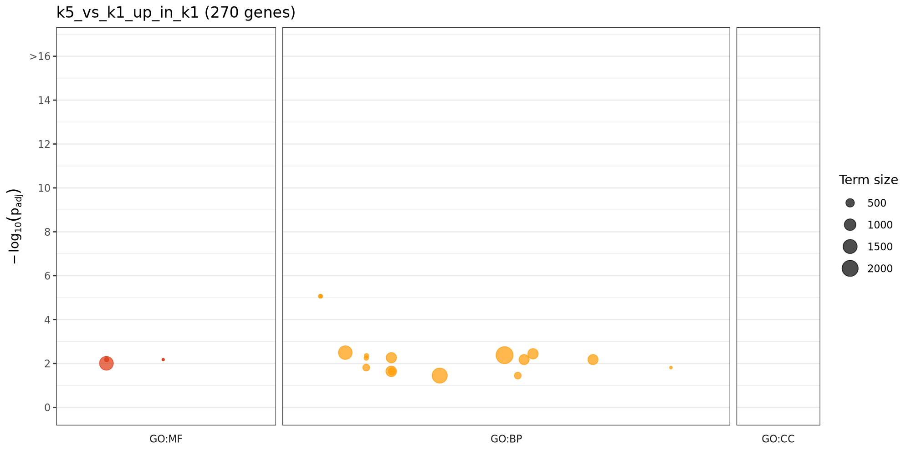

GO enrichment of k5 vs k1 DEGs (adjusted p < 0.05, |log2FC| ≥ 1) higher in k1. Same layout as g:Profiler. Each dot is one significant GO term (adjusted p < 0.05). Panels: GO:MF, GO:BP and GO:CC, with width proportional to the terms tested. Height: -log10(adjusted p), capped at 16. Dot size: background genes in the term.

### k5_vs_k1_up_in_k5_GO.png

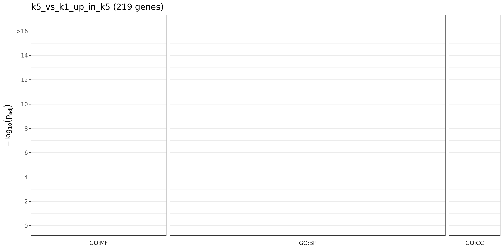

GO enrichment of k5 vs k1 DEGs (adjusted p < 0.05, |log2FC| ≥ 1) higher in k5. Same layout as g:Profiler. Each dot is one significant GO term (adjusted p < 0.05). Panels: GO:MF, GO:BP and GO:CC, with width proportional to the terms tested. Height: -log10(adjusted p), capped at 16. Dot size: background genes in the term.

## Tables

First 5 rows of each table. Values are rounded and long text is cut for display; at most 8 columns are shown. The files hold the full values.

### k10_vs_k1_up_in_k10_GO_significant.tsv

k10 vs k1 DEGs (adjusted p < 0.05, |log2FC| ≥ 1) higher in k10. Significant GO terms of this group (adjusted p < 0.05): namespace, term, term size, group genes in the term, annotated genes in the group and background, p, adjusted p and gene IDs.

[`k10_vs_k1_up_in_k10_GO_significant.tsv`](k10_vs_k1_up_in_k10_GO_significant.tsv): 47 rows, 10 columns.

All columns: `namespace`, `go_id`, `go_name`, `term_size`, `genes_in_term`, `list_annotated`, `universe_annotated`, `p_value`, `p_adj`, `genes`.

| namespace | go_id | go_name | term_size | genes_in_term | list_annotated | universe_annotated | p_value |
| --- | --- | --- | --- | --- | --- | --- | --- |
| biological_process | GO:0009408 | response to heat | 119 | 48 | 1586 | 15,565 | 4.815e-18 |
| biological_process | GO:0009266 | response to temperature stimulus | 226 | 65 | 1586 | 15,565 | 3.48e-15 |
| biological_process | GO:0006457 | protein folding | 219 | 55 | 1586 | 15,565 | 1.581e-10 |
| biological_process | GO:0050896 | response to stimulus | 3728 | 476 | 1586 | 15,565 | 3.165e-09 |
| biological_process | GO:0002239 | response to oomycetes | 80 | 27 | 1586 | 15,565 | 9.637e-09 |

### k10_vs_k1_up_in_k1_GO_significant.tsv

k10 vs k1 DEGs (adjusted p < 0.05, |log2FC| ≥ 1) higher in k1. Significant GO terms of this group (adjusted p < 0.05): namespace, term, term size, group genes in the term, annotated genes in the group and background, p, adjusted p and gene IDs.

[`k10_vs_k1_up_in_k1_GO_significant.tsv`](k10_vs_k1_up_in_k1_GO_significant.tsv): 11 rows, 10 columns.

All columns: `namespace`, `go_id`, `go_name`, `term_size`, `genes_in_term`, `list_annotated`, `universe_annotated`, `p_value`, `p_adj`, `genes`.

| namespace | go_id | go_name | term_size | genes_in_term | list_annotated | universe_annotated | p_value |
| --- | --- | --- | --- | --- | --- | --- | --- |
| biological_process | GO:0042254 | ribosome biogenesis | 340 | 42 | 809 | 15,565 | 1.645e-07 |
| biological_process | GO:0022613 | ribonucleoprotein complex biogenesis | 418 | 44 | 809 | 15,565 | 6.717e-06 |
| biological_process | GO:0031118 | rRNA pseudouridine synthesis | 13 | 6 | 809 | 15,565 | 2.424e-05 |
| biological_process | GO:0044085 | cellular component biogenesis | 1198 | 94 | 809 | 15,565 | 3.264e-05 |
| cellular_component | GO:0000786 | nucleosome | 144 | 20 | 715 | 14,266 | 3.3e-05 |

### k10_vs_k5_up_in_k10_GO_significant.tsv

k10 vs k5 DEGs (adjusted p < 0.05, |log2FC| ≥ 1) higher in k10. Significant GO terms of this group (adjusted p < 0.05): namespace, term, term size, group genes in the term, annotated genes in the group and background, p, adjusted p and gene IDs.

[`k10_vs_k5_up_in_k10_GO_significant.tsv`](k10_vs_k5_up_in_k10_GO_significant.tsv): 107 rows, 10 columns.

All columns: `namespace`, `go_id`, `go_name`, `term_size`, `genes_in_term`, `list_annotated`, `universe_annotated`, `p_value`, `p_adj`, `genes`.

| namespace | go_id | go_name | term_size | genes_in_term | list_annotated | universe_annotated | p_value |
| --- | --- | --- | --- | --- | --- | --- | --- |
| biological_process | GO:0006468 | protein phosphorylation | 1438 | 305 | 1968 | 15,565 | 7.007e-22 |
| biological_process | GO:0050896 | response to stimulus | 3728 | 631 | 1968 | 15,565 | 1.107e-18 |
| biological_process | GO:0002239 | response to oomycetes | 80 | 41 | 1968 | 15,565 | 7.104e-17 |
| biological_process | GO:0002229 | defense response to oomycetes | 78 | 40 | 1968 | 15,565 | 1.649e-16 |
| biological_process | GO:0016310 | phosphorylation | 1781 | 336 | 1968 | 15,565 | 9.55e-16 |

### k10_vs_k5_up_in_k5_GO_significant.tsv

k10 vs k5 DEGs (adjusted p < 0.05, |log2FC| ≥ 1) higher in k5. Significant GO terms of this group (adjusted p < 0.05): namespace, term, term size, group genes in the term, annotated genes in the group and background, p, adjusted p and gene IDs.

[`k10_vs_k5_up_in_k5_GO_significant.tsv`](k10_vs_k5_up_in_k5_GO_significant.tsv): 86 rows, 10 columns.

All columns: `namespace`, `go_id`, `go_name`, `term_size`, `genes_in_term`, `list_annotated`, `universe_annotated`, `p_value`, `p_adj`, `genes`.

| namespace | go_id | go_name | term_size | genes_in_term | list_annotated | universe_annotated | p_value |
| --- | --- | --- | --- | --- | --- | --- | --- |
| biological_process | GO:0006754 | ATP biosynthetic process | 90 | 45 | 1043 | 15,565 | 3.398e-29 |
| biological_process | GO:0015986 | proton motive force-driven ATP synthesis | 89 | 45 | 1043 | 15,565 | 1.813e-29 |
| biological_process | GO:0009145 | purine nucleoside triphosphate biosynthetic process | 96 | 45 | 1043 | 15,565 | 1.184e-27 |
| biological_process | GO:0009206 | purine ribonucleoside triphosphate biosynthetic process | 96 | 45 | 1043 | 15,565 | 1.184e-27 |
| biological_process | GO:0009142 | nucleoside triphosphate biosynthetic process | 110 | 46 | 1043 | 15,565 | 1.393e-25 |

### k12_vs_k10_up_in_k10_GO_significant.tsv

k12 vs k10 DEGs (adjusted p < 0.05, |log2FC| ≥ 1) higher in k10. Significant GO terms of this group (adjusted p < 0.05): namespace, term, term size, group genes in the term, annotated genes in the group and background, p, adjusted p and gene IDs.

[`k12_vs_k10_up_in_k10_GO_significant.tsv`](k12_vs_k10_up_in_k10_GO_significant.tsv): 77 rows, 10 columns.

All columns: `namespace`, `go_id`, `go_name`, `term_size`, `genes_in_term`, `list_annotated`, `universe_annotated`, `p_value`, `p_adj`, `genes`.

| namespace | go_id | go_name | term_size | genes_in_term | list_annotated | universe_annotated | p_value |
| --- | --- | --- | --- | --- | --- | --- | --- |
| biological_process | GO:0006468 | protein phosphorylation | 1438 | 198 | 1066 | 15,565 | 6.412e-23 |
| biological_process | GO:0050896 | response to stimulus | 3728 | 378 | 1066 | 15,565 | 1.36e-18 |
| biological_process | GO:0016310 | phosphorylation | 1781 | 215 | 1066 | 15,565 | 8.009e-18 |
| biological_process | GO:0006796 | phosphate-containing compound metabolic process | 2026 | 228 | 1066 | 15,565 | 2.502e-15 |
| biological_process | GO:0036211 | protein modification process | 2293 | 247 | 1066 | 15,565 | 2.148e-14 |

### k12_vs_k10_up_in_k12_GO_significant.tsv

k12 vs k10 DEGs (adjusted p < 0.05, |log2FC| ≥ 1) higher in k12. Significant GO terms of this group (adjusted p < 0.05): namespace, term, term size, group genes in the term, annotated genes in the group and background, p, adjusted p and gene IDs.

[`k12_vs_k10_up_in_k12_GO_significant.tsv`](k12_vs_k10_up_in_k12_GO_significant.tsv): 7 rows, 10 columns.

All columns: `namespace`, `go_id`, `go_name`, `term_size`, `genes_in_term`, `list_annotated`, `universe_annotated`, `p_value`, `p_adj`, `genes`.

| namespace | go_id | go_name | term_size | genes_in_term | list_annotated | universe_annotated | p_value |
| --- | --- | --- | --- | --- | --- | --- | --- |
| cellular_component | GO:0005786 | signal recognition particle, endoplasmic reticulum target… | 14 | 5 | 524 | 14,266 | 9.969e-05 |
| cellular_component | GO:0005874 | microtubule | 178 | 18 | 524 | 14,266 | 9.857e-05 |
| cellular_component | GO:0015630 | microtubule cytoskeleton | 223 | 20 | 524 | 14,266 | 0.0002159 |
| cellular_component | GO:0099080 | supramolecular complex | 329 | 26 | 524 | 14,266 | 0.0002078 |
| cellular_component | GO:0099081 | supramolecular polymer | 194 | 18 | 524 | 14,266 | 0.0002913 |

### k12_vs_k1_up_in_k12_GO_significant.tsv

k12 vs k1 DEGs (adjusted p < 0.05, |log2FC| ≥ 1) higher in k12. Significant GO terms of this group (adjusted p < 0.05): namespace, term, term size, group genes in the term, annotated genes in the group and background, p, adjusted p and gene IDs.

[`k12_vs_k1_up_in_k12_GO_significant.tsv`](k12_vs_k1_up_in_k12_GO_significant.tsv): 0 rows, 10 columns.

All columns: `namespace`, `go_id`, `go_name`, `term_size`, `genes_in_term`, `list_annotated`, `universe_annotated`, `p_value`, `p_adj`, `genes`.

| namespace | go_id | go_name | term_size | genes_in_term | list_annotated | universe_annotated | p_value |
| --- | --- | --- | --- | --- | --- | --- | --- |

### k12_vs_k1_up_in_k1_GO_significant.tsv

k12 vs k1 DEGs (adjusted p < 0.05, |log2FC| ≥ 1) higher in k1. Significant GO terms of this group (adjusted p < 0.05): namespace, term, term size, group genes in the term, annotated genes in the group and background, p, adjusted p and gene IDs.

[`k12_vs_k1_up_in_k1_GO_significant.tsv`](k12_vs_k1_up_in_k1_GO_significant.tsv): 0 rows, 10 columns.

All columns: `namespace`, `go_id`, `go_name`, `term_size`, `genes_in_term`, `list_annotated`, `universe_annotated`, `p_value`, `p_adj`, `genes`.

| namespace | go_id | go_name | term_size | genes_in_term | list_annotated | universe_annotated | p_value |
| --- | --- | --- | --- | --- | --- | --- | --- |

### k12_vs_k5_up_in_k12_GO_significant.tsv

k12 vs k5 DEGs (adjusted p < 0.05, |log2FC| ≥ 1) higher in k12. Significant GO terms of this group (adjusted p < 0.05): namespace, term, term size, group genes in the term, annotated genes in the group and background, p, adjusted p and gene IDs.

[`k12_vs_k5_up_in_k12_GO_significant.tsv`](k12_vs_k5_up_in_k12_GO_significant.tsv): 29 rows, 10 columns.

All columns: `namespace`, `go_id`, `go_name`, `term_size`, `genes_in_term`, `list_annotated`, `universe_annotated`, `p_value`, `p_adj`, `genes`.

| namespace | go_id | go_name | term_size | genes_in_term | list_annotated | universe_annotated | p_value |
| --- | --- | --- | --- | --- | --- | --- | --- |
| biological_process | GO:0050896 | response to stimulus | 3728 | 96 | 257 | 15,565 | 9.083e-07 |
| biological_process | GO:0002229 | defense response to oomycetes | 78 | 9 | 257 | 15,565 | 5.356e-06 |
| biological_process | GO:0002239 | response to oomycetes | 80 | 9 | 257 | 15,565 | 6.618e-06 |
| biological_process | GO:0043207 | response to external biotic stimulus | 764 | 30 | 257 | 15,565 | 9.698e-06 |
| biological_process | GO:0044419 | biological process involved in interspecies interaction b… | 798 | 31 | 257 | 15,565 | 8.439e-06 |

### k12_vs_k5_up_in_k5_GO_significant.tsv

k12 vs k5 DEGs (adjusted p < 0.05, |log2FC| ≥ 1) higher in k5. Significant GO terms of this group (adjusted p < 0.05): namespace, term, term size, group genes in the term, annotated genes in the group and background, p, adjusted p and gene IDs.

[`k12_vs_k5_up_in_k5_GO_significant.tsv`](k12_vs_k5_up_in_k5_GO_significant.tsv): 0 rows, 10 columns.

All columns: `namespace`, `go_id`, `go_name`, `term_size`, `genes_in_term`, `list_annotated`, `universe_annotated`, `p_value`, `p_adj`, `genes`.

| namespace | go_id | go_name | term_size | genes_in_term | list_annotated | universe_annotated | p_value |
| --- | --- | --- | --- | --- | --- | --- | --- |

### k14_vs_k10_up_in_k10_GO_significant.tsv

k14 vs k10 DEGs (adjusted p < 0.05, |log2FC| ≥ 1) higher in k10. Significant GO terms of this group (adjusted p < 0.05): namespace, term, term size, group genes in the term, annotated genes in the group and background, p, adjusted p and gene IDs.

[`k14_vs_k10_up_in_k10_GO_significant.tsv`](k14_vs_k10_up_in_k10_GO_significant.tsv): 72 rows, 10 columns.

All columns: `namespace`, `go_id`, `go_name`, `term_size`, `genes_in_term`, `list_annotated`, `universe_annotated`, `p_value`, `p_adj`, `genes`.

| namespace | go_id | go_name | term_size | genes_in_term | list_annotated | universe_annotated | p_value |
| --- | --- | --- | --- | --- | --- | --- | --- |
| biological_process | GO:0006468 | protein phosphorylation | 1438 | 156 | 944 | 15,565 | 1.751e-13 |
| biological_process | GO:0016310 | phosphorylation | 1781 | 177 | 944 | 15,565 | 7.69e-12 |
| biological_process | GO:0006796 | phosphate-containing compound metabolic process | 2026 | 187 | 944 | 15,565 | 9.68e-10 |
| biological_process | GO:0009607 | response to biotic stimulus | 790 | 92 | 944 | 15,565 | 8.323e-10 |
| biological_process | GO:0050896 | response to stimulus | 3728 | 305 | 944 | 15,565 | 1.109e-09 |

### k14_vs_k10_up_in_k14_GO_significant.tsv

k14 vs k10 DEGs (adjusted p < 0.05, |log2FC| ≥ 1) higher in k14. Significant GO terms of this group (adjusted p < 0.05): namespace, term, term size, group genes in the term, annotated genes in the group and background, p, adjusted p and gene IDs.

[`k14_vs_k10_up_in_k14_GO_significant.tsv`](k14_vs_k10_up_in_k14_GO_significant.tsv): 1 rows, 10 columns.

All columns: `namespace`, `go_id`, `go_name`, `term_size`, `genes_in_term`, `list_annotated`, `universe_annotated`, `p_value`, `p_adj`, `genes`.

| namespace | go_id | go_name | term_size | genes_in_term | list_annotated | universe_annotated | p_value |
| --- | --- | --- | --- | --- | --- | --- | --- |
| cellular_component | GO:0015935 | small ribosomal subunit | 12 | 6 | 430 | 14,266 | 5.738e-07 |

### k14_vs_k12_up_in_k12_GO_significant.tsv

k14 vs k12 DEGs (adjusted p < 0.05, |log2FC| ≥ 1) higher in k12. Significant GO terms of this group (adjusted p < 0.05): namespace, term, term size, group genes in the term, annotated genes in the group and background, p, adjusted p and gene IDs.

[`k14_vs_k12_up_in_k12_GO_significant.tsv`](k14_vs_k12_up_in_k12_GO_significant.tsv): 43 rows, 10 columns.

All columns: `namespace`, `go_id`, `go_name`, `term_size`, `genes_in_term`, `list_annotated`, `universe_annotated`, `p_value`, `p_adj`, `genes`.

| namespace | go_id | go_name | term_size | genes_in_term | list_annotated | universe_annotated | p_value |
| --- | --- | --- | --- | --- | --- | --- | --- |
| biological_process | GO:0042773 | ATP synthesis coupled electron transport | 85 | 28 | 575 | 15,565 | 1.295e-19 |
| biological_process | GO:0006119 | oxidative phosphorylation | 91 | 28 | 575 | 15,565 | 1.032e-18 |
| biological_process | GO:0022904 | respiratory electron transport chain | 111 | 28 | 575 | 15,565 | 3.384e-16 |
| biological_process | GO:0015988 | energy coupled proton transmembrane transport, against el… | 114 | 28 | 575 | 15,565 | 7.166e-16 |
| biological_process | GO:0015990 | electron transport coupled proton transport | 114 | 28 | 575 | 15,565 | 7.166e-16 |

### k14_vs_k12_up_in_k14_GO_significant.tsv

k14 vs k12 DEGs (adjusted p < 0.05, |log2FC| ≥ 1) higher in k14. Significant GO terms of this group (adjusted p < 0.05): namespace, term, term size, group genes in the term, annotated genes in the group and background, p, adjusted p and gene IDs.

[`k14_vs_k12_up_in_k14_GO_significant.tsv`](k14_vs_k12_up_in_k14_GO_significant.tsv): 0 rows, 10 columns.

All columns: `namespace`, `go_id`, `go_name`, `term_size`, `genes_in_term`, `list_annotated`, `universe_annotated`, `p_value`, `p_adj`, `genes`.

| namespace | go_id | go_name | term_size | genes_in_term | list_annotated | universe_annotated | p_value |
| --- | --- | --- | --- | --- | --- | --- | --- |

### k14_vs_k1_up_in_k14_GO_significant.tsv

k14 vs k1 DEGs (adjusted p < 0.05, |log2FC| ≥ 1) higher in k14. Significant GO terms of this group (adjusted p < 0.05): namespace, term, term size, group genes in the term, annotated genes in the group and background, p, adjusted p and gene IDs.

[`k14_vs_k1_up_in_k14_GO_significant.tsv`](k14_vs_k1_up_in_k14_GO_significant.tsv): 16 rows, 10 columns.

All columns: `namespace`, `go_id`, `go_name`, `term_size`, `genes_in_term`, `list_annotated`, `universe_annotated`, `p_value`, `p_adj`, `genes`.

| namespace | go_id | go_name | term_size | genes_in_term | list_annotated | universe_annotated | p_value |
| --- | --- | --- | --- | --- | --- | --- | --- |
| biological_process | GO:0009408 | response to heat | 119 | 31 | 1096 | 15,565 | 1.104e-10 |
| biological_process | GO:0009266 | response to temperature stimulus | 226 | 44 | 1096 | 15,565 | 5.28e-10 |
| biological_process | GO:0009628 | response to abiotic stimulus | 554 | 75 | 1096 | 15,565 | 2.898e-08 |
| biological_process | GO:0042542 | response to hydrogen peroxide | 48 | 15 | 1096 | 15,565 | 5.658e-07 |
| biological_process | GO:0051259 | protein complex oligomerization | 57 | 16 | 1096 | 15,565 | 1.208e-06 |

### k14_vs_k1_up_in_k1_GO_significant.tsv

k14 vs k1 DEGs (adjusted p < 0.05, |log2FC| ≥ 1) higher in k1. Significant GO terms of this group (adjusted p < 0.05): namespace, term, term size, group genes in the term, annotated genes in the group and background, p, adjusted p and gene IDs.

[`k14_vs_k1_up_in_k1_GO_significant.tsv`](k14_vs_k1_up_in_k1_GO_significant.tsv): 26 rows, 10 columns.

All columns: `namespace`, `go_id`, `go_name`, `term_size`, `genes_in_term`, `list_annotated`, `universe_annotated`, `p_value`, `p_adj`, `genes`.

| namespace | go_id | go_name | term_size | genes_in_term | list_annotated | universe_annotated | p_value |
| --- | --- | --- | --- | --- | --- | --- | --- |
| biological_process | GO:0042773 | ATP synthesis coupled electron transport | 85 | 28 | 1064 | 15,565 | 8.73e-13 |
| biological_process | GO:0006119 | oxidative phosphorylation | 91 | 28 | 1064 | 15,565 | 5.749e-12 |
| biological_process | GO:0022904 | respiratory electron transport chain | 111 | 28 | 1064 | 15,565 | 9.989e-10 |
| biological_process | GO:0015988 | energy coupled proton transmembrane transport, against el… | 114 | 28 | 1064 | 15,565 | 1.924e-09 |
| biological_process | GO:0015990 | electron transport coupled proton transport | 114 | 28 | 1064 | 15,565 | 1.924e-09 |

### k14_vs_k5_up_in_k14_GO_significant.tsv

k14 vs k5 DEGs (adjusted p < 0.05, |log2FC| ≥ 1) higher in k14. Significant GO terms of this group (adjusted p < 0.05): namespace, term, term size, group genes in the term, annotated genes in the group and background, p, adjusted p and gene IDs.

[`k14_vs_k5_up_in_k14_GO_significant.tsv`](k14_vs_k5_up_in_k14_GO_significant.tsv): 46 rows, 10 columns.

All columns: `namespace`, `go_id`, `go_name`, `term_size`, `genes_in_term`, `list_annotated`, `universe_annotated`, `p_value`, `p_adj`, `genes`.

| namespace | go_id | go_name | term_size | genes_in_term | list_annotated | universe_annotated | p_value |
| --- | --- | --- | --- | --- | --- | --- | --- |
| biological_process | GO:0007166 | cell surface receptor signaling pathway | 319 | 57 | 1046 | 15,565 | 8.359e-12 |
| biological_process | GO:0006468 | protein phosphorylation | 1438 | 153 | 1046 | 15,565 | 3.563e-09 |
| biological_process | GO:0002229 | defense response to oomycetes | 78 | 21 | 1046 | 15,565 | 2.667e-08 |
| biological_process | GO:0002239 | response to oomycetes | 80 | 21 | 1046 | 15,565 | 4.329e-08 |
| biological_process | GO:0007167 | enzyme-linked receptor protein signaling pathway | 112 | 25 | 1046 | 15,565 | 7.738e-08 |

### k14_vs_k5_up_in_k5_GO_significant.tsv

k14 vs k5 DEGs (adjusted p < 0.05, |log2FC| ≥ 1) higher in k5. Significant GO terms of this group (adjusted p < 0.05): namespace, term, term size, group genes in the term, annotated genes in the group and background, p, adjusted p and gene IDs.

[`k14_vs_k5_up_in_k5_GO_significant.tsv`](k14_vs_k5_up_in_k5_GO_significant.tsv): 33 rows, 10 columns.

All columns: `namespace`, `go_id`, `go_name`, `term_size`, `genes_in_term`, `list_annotated`, `universe_annotated`, `p_value`, `p_adj`, `genes`.

| namespace | go_id | go_name | term_size | genes_in_term | list_annotated | universe_annotated | p_value |
| --- | --- | --- | --- | --- | --- | --- | --- |
| biological_process | GO:0006119 | oxidative phosphorylation | 91 | 30 | 950 | 15,565 | 6.562e-15 |
| biological_process | GO:0042773 | ATP synthesis coupled electron transport | 85 | 28 | 950 | 15,565 | 5.372e-14 |
| biological_process | GO:0009451 | RNA modification | 438 | 70 | 950 | 15,565 | 8.389e-14 |
| biological_process | GO:0022904 | respiratory electron transport chain | 111 | 29 | 950 | 15,565 | 1.342e-11 |
| biological_process | GO:0015988 | energy coupled proton transmembrane transport, against el… | 114 | 28 | 950 | 15,565 | 1.47e-10 |

### k5_vs_k1_up_in_k1_GO_significant.tsv

k5 vs k1 DEGs (adjusted p < 0.05, |log2FC| ≥ 1) higher in k1. Significant GO terms of this group (adjusted p < 0.05): namespace, term, term size, group genes in the term, annotated genes in the group and background, p, adjusted p and gene IDs.

[`k5_vs_k1_up_in_k1_GO_significant.tsv`](k5_vs_k1_up_in_k1_GO_significant.tsv): 20 rows, 10 columns.

All columns: `namespace`, `go_id`, `go_name`, `term_size`, `genes_in_term`, `list_annotated`, `universe_annotated`, `p_value`, `p_adj`, `genes`.

| namespace | go_id | go_name | term_size | genes_in_term | list_annotated | universe_annotated | p_value |
| --- | --- | --- | --- | --- | --- | --- | --- |
| biological_process | GO:0002229 | defense response to oomycetes | 78 | 11 | 235 | 15,565 | 2.351e-08 |
| biological_process | GO:0002239 | response to oomycetes | 80 | 11 | 235 | 15,565 | 3.083e-08 |
| biological_process | GO:0044419 | biological process involved in interspecies interaction b… | 798 | 34 | 235 | 15,565 | 4.147e-08 |
| biological_process | GO:0009607 | response to biotic stimulus | 790 | 33 | 235 | 15,565 | 1.067e-07 |
| biological_process | GO:0043207 | response to external biotic stimulus | 764 | 32 | 235 | 15,565 | 1.601e-07 |

### k5_vs_k1_up_in_k5_GO_significant.tsv

k5 vs k1 DEGs (adjusted p < 0.05, |log2FC| ≥ 1) higher in k5. Significant GO terms of this group (adjusted p < 0.05): namespace, term, term size, group genes in the term, annotated genes in the group and background, p, adjusted p and gene IDs.

[`k5_vs_k1_up_in_k5_GO_significant.tsv`](k5_vs_k1_up_in_k5_GO_significant.tsv): 0 rows, 10 columns.

All columns: `namespace`, `go_id`, `go_name`, `term_size`, `genes_in_term`, `list_annotated`, `universe_annotated`, `p_value`, `p_adj`, `genes`.

| namespace | go_id | go_name | term_size | genes_in_term | list_annotated | universe_annotated | p_value |
| --- | --- | --- | --- | --- | --- | --- | --- |
