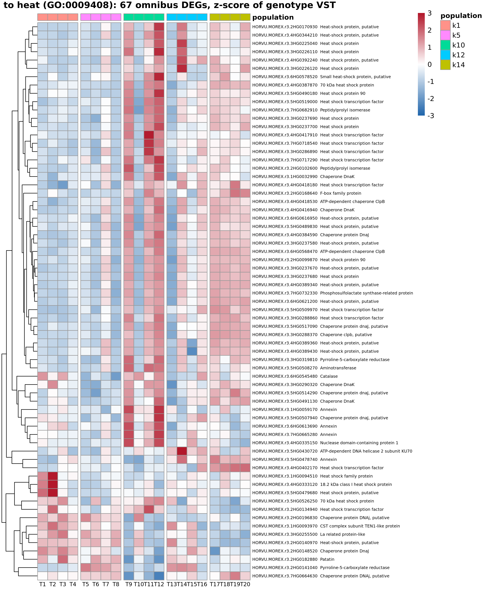
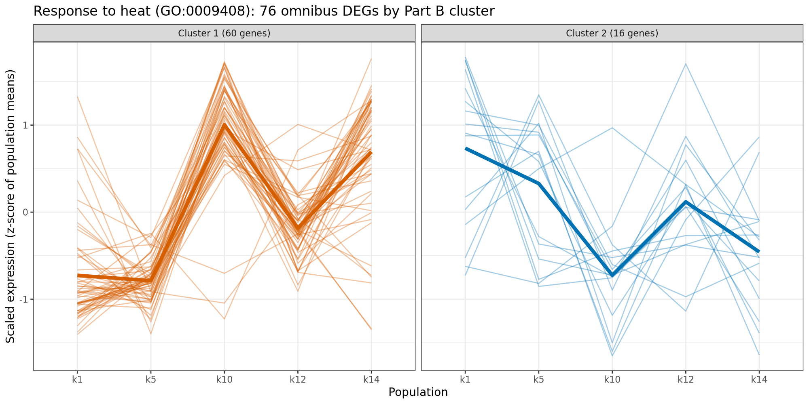
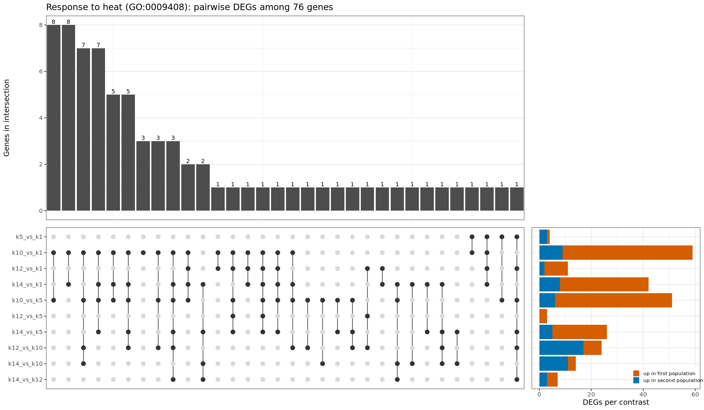

# Part C — Gene cherry-picking: response to heat

## Index of figures

| Figure | Content |
|---|---|
| [`heat_response_heatmap.png`](#heat_response_heatmappng) | The omnibus DEGs annotated to GO:0009408. |
| [`heat_response_patterns.png`](#heat_response_patternspng) | Each thin line is one gene's mean expression per population, scaled as in Part B. |
| [`heat_response_upset.png`](#heat_response_upsetpng) | Overlap of the pairwise DEG sets for these genes; all non-empty intersections. |

## Index of tables

| Table | Rows | Columns |
|---|---:|---:|
| [`heat_response_genes.tsv`](#heat_response_genestsv) | 76 | 3 |
| [`heat_response_upset_intersections.tsv`](#heat_response_upset_intersectionstsv) | 32 | 3 |

## Figures

### heat_response_heatmap.png

The omnibus DEGs annotated to GO:0009408. One column per genotype (3 plants summed, variance-stabilised), scaled per gene (z-score): red is higher than the gene's average, blue lower. White gaps separate populations; genes are clustered by profile.

### heat_response_patterns.png

Each thin line is one gene's mean expression per population, scaled as in Part B. Panels: the two Part B clusters. Thick line: cluster mean.

### heat_response_upset.png

Overlap of the pairwise DEG sets for these genes; all non-empty intersections. Right bars: orange is higher in the first population of the contrast, blue in the second.

## Tables

First 5 rows of each table. Values are rounded and long text is cut for display; at most 8 columns are shown. The files hold the full values.

### heat_response_genes.tsv

The heat-response DEGs: gene ID, description and omnibus adjusted p.

[`heat_response_genes.tsv`](heat_response_genes.tsv): 76 rows, 3 columns.

| gene_id | description | omnibus_padj |
| --- | --- | --- |
| HORVU.MOREX.r3.1HG0093970 | CST complex subunit TEN1-like protein | 0.0005162 |
| HORVU.MOREX.r3.2HG0141040 | Pyrroline-5-carboxylate reductase | 2.714e-17 |
| HORVU.MOREX.r3.2HG0148520 | Chaperone protein DnaJ | 0.008568 |
| HORVU.MOREX.r3.2HG0168640 | F-box family protein | 0.007674 |
| HORVU.MOREX.r3.2HG0196830 | Chaperone protein DNAj, putative | 0.005205 |

### heat_response_upset_intersections.tsv

Genes per intersection of the UpSet plot.

[`heat_response_upset_intersections.tsv`](heat_response_upset_intersections.tsv): 32 rows, 3 columns.

| id | pattern | genes |
| --- | --- | --- |
| 1 | k10_vs_k1 & k10_vs_k5 | 8 |
| 2 | k10_vs_k1 & k14_vs_k1 | 8 |
| 3 | k10_vs_k1 & k10_vs_k5 & k12_vs_k10 & k14_vs_k10 | 7 |
| 4 | k10_vs_k1 & k14_vs_k1 & k10_vs_k5 & k14_vs_k5 | 7 |
| 5 | k10_vs_k1 & k14_vs_k1 & k10_vs_k5 | 5 |
