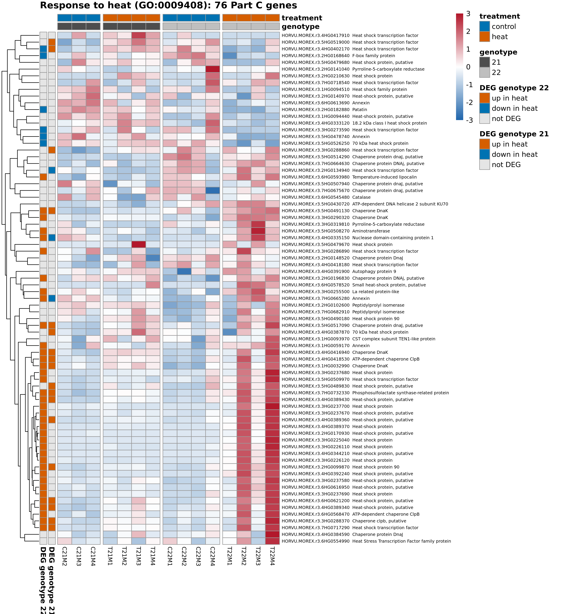
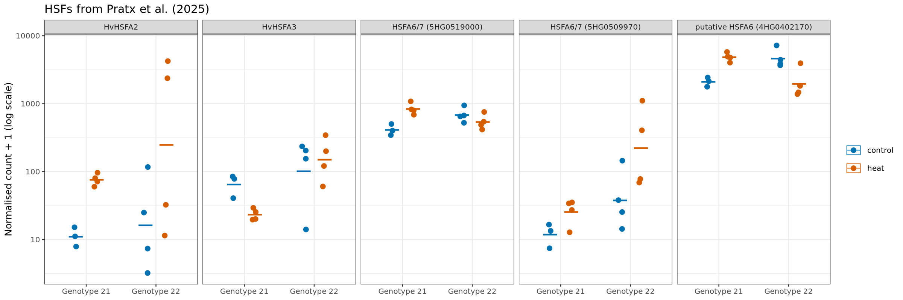
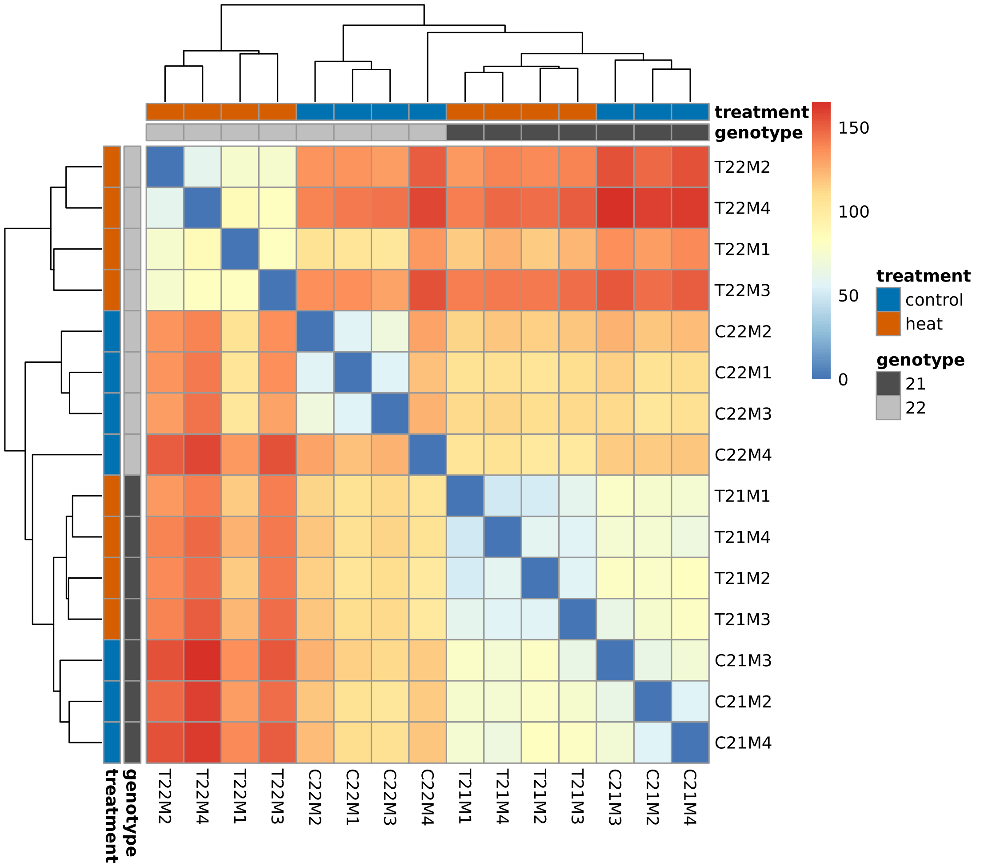
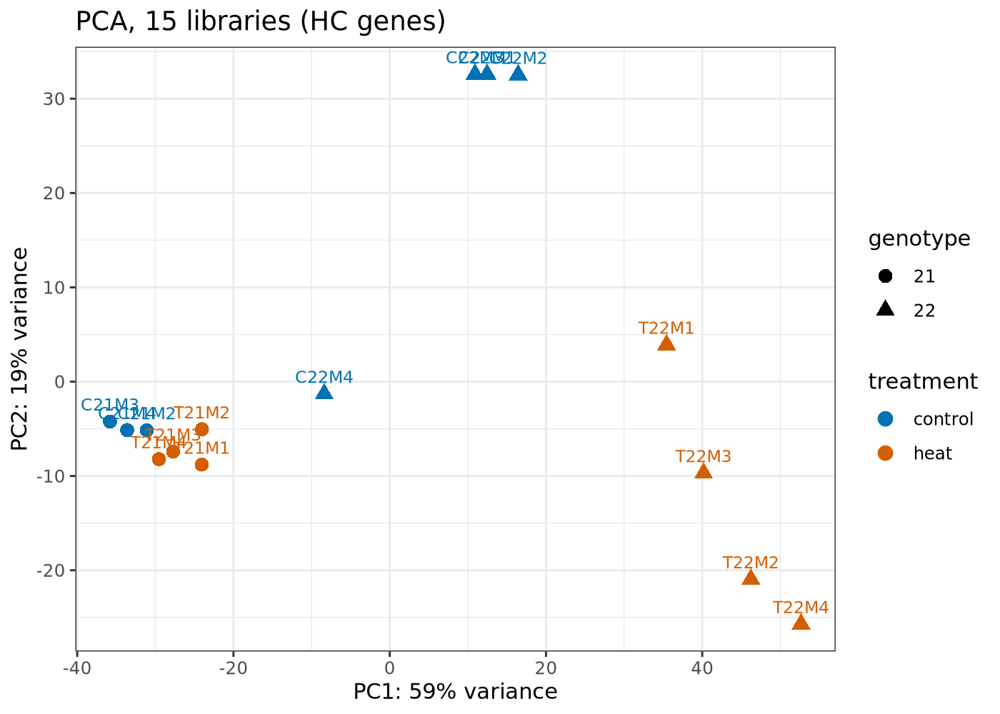
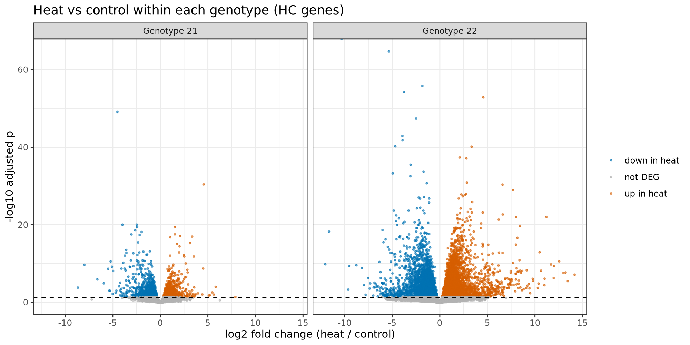

# Part E — Control validation

## Index of figures

| Figure | Content |
|---|---|
| [`heat_response_heatmap.png`](#heat_response_heatmappng) | The Part C genes in the 15 libraries, grouped by genotype and treatment. |
| [`hsf_expression.png`](#hsf_expressionpng) | One panel per HSF; each dot is one plant. |
| [`library_distances.png`](#library_distancespng) | Euclidean distance between libraries. |
| [`pca_libraries.png`](#pca_librariespng) | PCA of the 15 libraries (variance-stabilised, blind to the design). |
| [`volcano.png`](#volcanopng) | One panel per genotype; each dot is a gene. |

## Index of tables

| Table | Rows | Columns |
|---|---:|---:|
| [`heat_response_genes_E.tsv`](#heat_response_genes_etsv) | 76 | 6 |
| [`heat_vs_control_G21.tsv`](#heat_vs_control_g21tsv) | 35,827 | 7 |
| [`heat_vs_control_G22.tsv`](#heat_vs_control_g22tsv) | 35,827 | 7 |
| [`heat_vs_control_summary.tsv`](#heat_vs_control_summarytsv) | 2 | 7 |
| [`hsf_normalised_counts.tsv`](#hsf_normalised_countstsv) | 75 | 5 |
| [`library_table.tsv`](#library_tabletsv) | 15 | 4 |
| [`size_factors.tsv`](#size_factorstsv) | 15 | 2 |

## Figures

### heat_response_heatmap.png

The Part C genes in the 15 libraries, grouped by genotype and treatment. Variance-stabilised expression scaled per gene (z-score). The left bars mark DEGs in each genotype (orange: up in heat; blue: down; grey: not DEG).

### hsf_expression.png

One panel per HSF; each dot is one plant. Normalised count + 1 on a log scale. Blue: control; orange: heat. The bar is the geometric mean of normalised count + 1.

### library_distances.png

Euclidean distance between libraries. Blue: similar; red: different. Clustered with complete linkage; the bars show treatment and genotype.

### pca_libraries.png

PCA of the 15 libraries (variance-stabilised, blind to the design). Colour: treatment. Shape: genotype. Axis labels give the variance explained.

### volcano.png

One panel per genotype; each dot is a gene. x: log2 fold change (heat / control). y: -log10 adjusted p. Dashed line: adjusted p = 0.05. Orange: DEG higher in heat; blue: DEG lower in heat; grey: not DEG.

## Tables

First 5 rows of each table. Values are rounded and long text is cut for display; at most 8 columns are shown. The files hold the full values.

### heat_response_genes_E.tsv

The Part C genes: log2 fold change and adjusted p in each genotype.

[`heat_response_genes_E.tsv`](heat_response_genes_E.tsv): 76 rows, 6 columns.

| gene_id | description | log2FC_G21 | padj_G21 | log2FC_G22 | padj_G22 |
| --- | --- | --- | --- | --- | --- |
| HORVU.MOREX.r3.1HG0093970 | CST complex subunit TEN1-like protein | 0.2319 | 0.6529 | 0.1952 | 0.583 |
| HORVU.MOREX.r3.2HG0141040 | Pyrroline-5-carboxylate reductase | -2.048 | NA | -2.987 | NA |
| HORVU.MOREX.r3.2HG0148520 | Chaperone protein DnaJ | 0.2629 | 0.7497 | -0.1568 | 0.6261 |
| HORVU.MOREX.r3.2HG0168640 | F-box family protein | -0.0388 | 0.9155 | -0.733 | 0.0002744 |
| HORVU.MOREX.r3.2HG0196830 | Chaperone protein DNAj, putative | 0.242 | 0.5987 | 1.429 | 9.097e-06 |

### heat_vs_control_G21.tsv

Heat vs control in genotype 21. DESeq2 results for every gene: mean normalised count (`baseMean`), log2 fold change, standard error, test statistic, p and adjusted p.

[`heat_vs_control_G21.tsv`](heat_vs_control_G21.tsv): 35,827 rows, 7 columns.

| gene_id | baseMean | log2FoldChange | lfcSE | stat | pvalue | padj |
| --- | --- | --- | --- | --- | --- | --- |
| HORVU.MOREX.r3.5HG0430240 | 625.1 | -4.512 | 0.2914 | -15.48 | 4.613e-54 | 8.153e-50 |
| HORVU.MOREX.r3.4HG0357420 | 2.866e+04 | 4.554 | 0.3684 | 12.36 | 4.232e-35 | 3.74e-31 |
| HORVU.MOREX.r3.5HG0526120 | 274.1 | -3.981 | 0.3905 | -10.19 | 2.1e-24 | 9.47e-21 |
| HORVU.MOREX.r3.7HG0715810 | 1749 | -2.471 | 0.2424 | -10.19 | 2.143e-24 | 9.47e-21 |
| HORVU.MOREX.r3.1HG0029910 | 197.7 | -2.432 | 0.2423 | -10.04 | 1.058e-23 | 3.741e-20 |

### heat_vs_control_G22.tsv

Heat vs control in genotype 22. DESeq2 results for every gene: mean normalised count (`baseMean`), log2 fold change, standard error, test statistic, p and adjusted p.

[`heat_vs_control_G22.tsv`](heat_vs_control_G22.tsv): 35,827 rows, 7 columns.

| gene_id | baseMean | log2FoldChange | lfcSE | stat | pvalue | padj |
| --- | --- | --- | --- | --- | --- | --- |
| HORVU.MOREX.r3.7HG0719110 | 6640 | -10.34 | 0.2662 | -38.83 | 0 | 0 |
| HORVU.MOREX.r3.5HG0502770 | 329.6 | -5.354 | 0.304 | -17.61 | 2.041e-69 | 2.074e-65 |
| HORVU.MOREX.r3.6HG0621190 | 1866 | -1.839 | 0.1122 | -16.39 | 2.291e-60 | 1.551e-56 |
| HORVU.MOREX.r3.3HG0255420 | 990.6 | -3.779 | 0.234 | -16.15 | 1.159e-58 | 5.888e-55 |
| HORVU.MOREX.r3.4HG0335790 | 666.5 | 4.569 | 0.2866 | 15.94 | 3.337e-57 | 1.356e-53 |

### heat_vs_control_summary.tsv

Plants, genes tested and DEGs per genotype.

[`heat_vs_control_summary.tsv`](heat_vs_control_summary.tsv): 2 rows, 7 columns.

| genotype | control_plants | heat_plants | genes_tested | DEGs | up_in_heat | down_in_heat |
| --- | --- | --- | --- | --- | --- | --- |
| 21 | 3 | 4 | 17,674 | 1929 | 897 | 1032 |
| 22 | 4 | 4 | 20,316 | 8213 | 4110 | 4103 |

### hsf_normalised_counts.tsv

Normalised counts of the 5 HSFs per library.

[`hsf_normalised_counts.tsv`](hsf_normalised_counts.tsv): 75 rows, 5 columns.

| gene | library | count | genotype | treatment |
| --- | --- | --- | --- | --- |
| HvHSFA2 | C21M2 | 14.22 | Genotype 21 | control |
| HvHSFA2 | C21M3 | 10.17 | Genotype 21 | control |
| HvHSFA2 | C21M4 | 6.913 | Genotype 21 | control |
| HvHSFA2 | C22M1 | 6.38 | Genotype 22 | control |
| HvHSFA2 | C22M2 | 24.02 | Genotype 22 | control |

### library_table.tsv

Library (corrected label), treatment, genotype and plant.

[`library_table.tsv`](library_table.tsv): 15 rows, 4 columns.

| library | treatment | genotype | plant |
| --- | --- | --- | --- |
| C21M2 | control | 21 | M2 |
| C21M3 | control | 21 | M3 |
| C21M4 | control | 21 | M4 |
| C22M1 | control | 22 | M1 |
| C22M2 | control | 22 | M2 |

### size_factors.tsv

DESeq2 size factors of the 15 libraries.

[`size_factors.tsv`](size_factors.tsv): 15 rows, 2 columns.

| library | size_factor |
| --- | --- |
| C21M2 | 0.7034 |
| C21M3 | 1.082 |
| C21M4 | 0.7233 |
| C22M1 | 0.9405 |
| C22M2 | 0.9158 |
